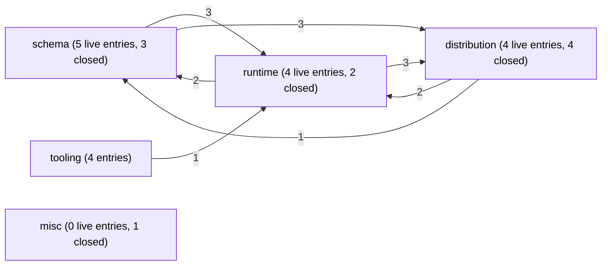
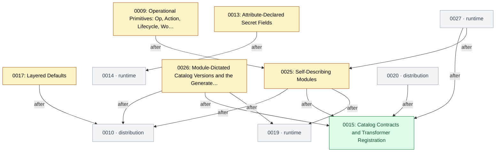
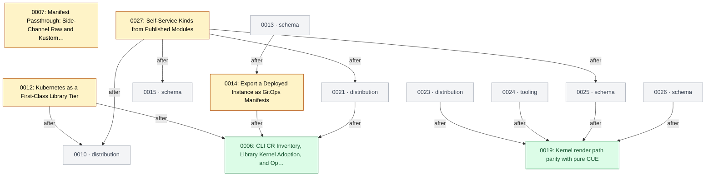
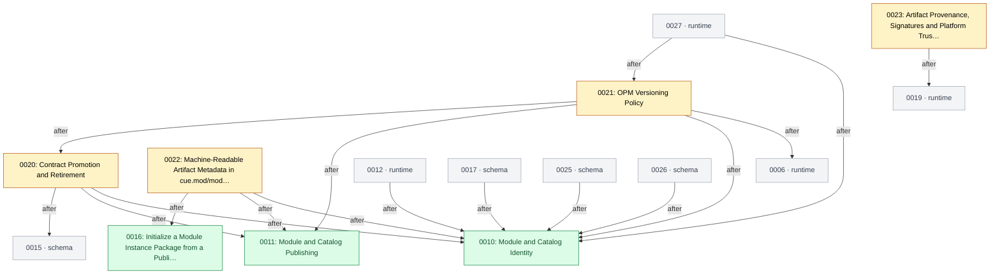
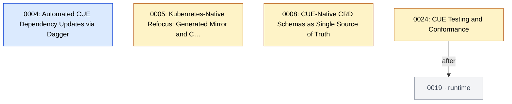
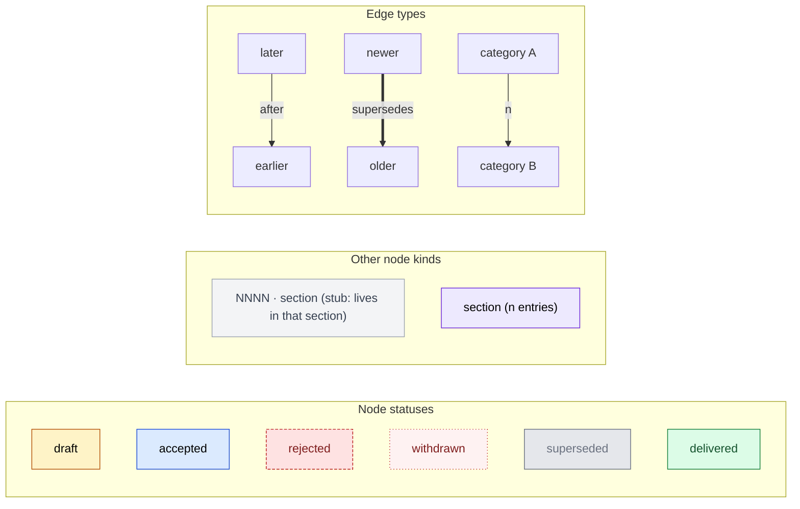

# Enhancement Relationship Graph

<!-- Generated by `task index` — do not edit by hand. -->

Entries are partitioned by `config.yaml.category`, the type of work. The Overview
shows how the categories lean on each other; each section shows one category
with its foreign neighbours drawn as grey stubs. Closed entries (delivered,
rejected, superseded, withdrawn) appear only where a live entry reaches them.

## Overview

One node per category, live and closed entry counts in the label. An edge label
counts the `after` edges that cross from one category into another; edges
inside a category are not shown here, and `superseded_by` is a lifecycle
relation rather than layering, so it is left to the sections.

Mutually dependent categories (informational; the entry-level `after` graph stays acyclic, `task vet` enforces it): schema ↔ runtime, schema ↔ distribution, runtime ↔ distribution.

## schema

## runtime

## distribution

## tooling

## misc

No live entries.

## Legend

A stub is an entry that lives in another section; its label names the section to jump to. `after` is a soft hint that an entry follows another; it blocks nothing. In the Overview, an edge label `n` counts the `after` edges crossing from A into B. Closed entries (delivered, rejected, superseded, withdrawn) appear only where a live entry's edge reaches them.
