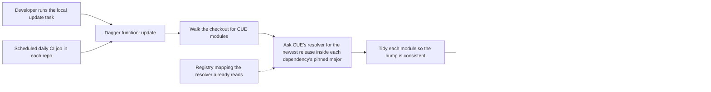

# 0004 design: Automated CUE Dependency Updates via Dagger

## How it works

The function takes a directory, the registry mapping and a token for private modules. It returns the changed tree and an old-to-new summary. It does not know who called it, so one call serves a developer and a CI job. Only what happens to the returned tree differs.

## Design

### One path-driven function, not a hosted bot

The mechanism is a Dagger function. Point it at a directory and it walks for CUE modules. For each module it reads the dependency keys, asks CUE's own resolver for the newest release of each, then tidies the module. This is the logic of the current workspace task, lifted out of shell into a typed, containerised unit that runs the same way everywhere. The signature is the stable contract that every caller depends on: a source directory, the registry mapping and a registry token in, a directory out.

Using CUE's resolver removes two things a third-party manager would need. There is no route table that mirrors the registry mapping, so nothing can drift from it. There is no regex that rewrites version strings, because the resolver and the tidy step read and rewrite the dependency block themselves. The only parsing left is reading the existing keys, exactly as the current task does.

The accepted cost: the Dagger engine becomes a CI dependency in every enrolled repo. The first design used self-hosted Renovate. It was replaced the next day, because its detection layer reimplemented the resolver by hand. The old decisions stay in the evidence folder.

### The major is never crossed

Each dependency key already names its major. The resolver returns only releases inside that major, so a newer major published in the same registry repository is never offered. The guard is free: no package rule, no ceiling table. Crossing a major changes import paths and needs code changes, so it stays a human job.

### Local and scheduled runs share one implementation

The workspace update task keeps its name and its interface. Its body becomes a call to the same function that CI runs. A tree bumped by either path gives the same result. This removes the risk that a local sweep and a scheduled job disagree. The faster local one-shot over the whole workspace stays, which is why the task is kept and not removed.

The CLI's module templates are not valid CUE modules until rendered. The function handles them the way the current task does: render to a scratch module, bump, and write back. The function reuses the current discovery logic for this reason.

### One grouped pull request per repo per run

A scheduled run opens at most one pull request per repo, on a fixed branch, holding every bump of that run. A later run that finds new bumps updates the open pull request in place. A run whose bumps no longer differ from the base closes it. The fixed branch gives "update the same pull request" with no custom lifecycle code. The dependency set per repo is small, so one grouped pull request keeps the review surface to one page. The job runs daily in every enrolled repo, and the repo's own CI re-vets each bump before merge.

### Everything is bumped, fixtures too

No path is excluded from discovery. A stale test fixture is a worse signal than a reviewable pull request, because fixtures that fall off current dependencies hide real incompatibilities until late. The grouped daily pull request bounds the churn to one per repo. A measurement of 2026-09-29 shows the modules sit one to five directories down and that most of the library repo's modules are fixtures, so a fixed list of module directories would need 59 hand-kept entries across the six repos. Discovery is path-driven instead.

### Shared parts live once

The Dagger module lives in the organisation's daggerverse repo, in its own subdirectory with its own version tags. The reusable workflow lives in the organisation's `.github` repo, authored once. Each enrolled repo carries a short caller with a daily trigger that passes the registry mapping and a token. There is no per-repo list of module directories, so adding a repo configures nothing new. The caller needs a registry token with package read scope for the private `opmodel.dev` modules. The external `cue.dev` modules resolve through a public registry that needs none.

### CUE only, other ecosystems parked

Go modules, Action pins and Dockerfiles are out. A later investigation of running Renovate inside Dagger found two shapes. Wrapping Renovate to do everything brings back the route table and the regex, and Renovate has no mode that both runs offline and changes files. One composed module with two engines is possible but is a second engine under one front door, with a different pull request model. That shape is recorded as the starting point of a future multi-ecosystem entry, not as a decision here. Dependabot for Go repos is orthogonal config a Go repo can add alone.

### Rollout is per repo and reversible

The shared module ships first, then the reusable workflow, because the callers have nothing to point at before both exist. The Taskfile rewire is independent and validates early that the function reproduces the old shell behaviour. Each enrolled repo then adds its caller on its own, with no order between repos. One pilot repo should prove discovery, tidy and auth end to end before the rest. Rollback is per repo: disable the schedule and the bumps stop with no residual state. Merged bumps revert like any commit. The task body can return to shell if the wrapper regresses.

## Risks

- **Tidy runs without its environment.** Without the resolver on the path, the registry mapping or a token, the pull request is empty or partial. The function provisions the tools and auth in its container, and the repo's own CI re-vets the pull request, so an inconsistent bump cannot merge green.
- **The registry token expires or lacks scope.** Internal bumps stop. The workflow's own token with package read scope is used, and a failure is a failed run, not a silent no-op.
- **The Dagger engine breaks or skews.** All dependency pull requests stop for a day. The module reference is pinned, failures stay in the scheduled job, and no runtime is touched.
- **Discovery misses a module shape.** A missed shape means silent staleness. The function reuses the current discovery logic, which handles both module and template shapes, and the pilot repo checks it end to end.
- **A core release fans out.** Each downstream repo gets a pull request and a CI run. The grouped daily pull request collapses this to one per repo, and schedules can be staggered if cost warrants.
- **Drawbacks.** A pull request carries versions, not release notes. Coverage is CUE only, where a hosted bot would have covered more.

## Considered and rejected

- Considered a hosted Mend Renovate app; rejected because the hosted app disallows the post-upgrade tasks that run tidy, so bumps could not be made consistent.
- Considered a hybrid where the hosted app opens bump pull requests and the repo's CI fails if tidy would change anything; rejected because tidy is never applied and every pull request needs a manual tidy.
- Considered self-hosted Renovate with a regex manager and the container-registry datasource; rejected because it needs a hand-kept route table and a version regex that CUE's resolver makes unnecessary.
- Considered a GitHub-releases datasource for internal modules; rejected because it needs a name-to-repo map and still cannot cover external modules.
- Considered per-dependency allowed-version ceilings to hold the major; rejected because it is more config and one mistake silently breaks an import path.
- Considered plain shell in a workflow; rejected because it is not runnable locally and becomes a third copy of the bump logic.
- Considered a cron job that runs the current task; rejected because the task needs every repo checked out, so it could not live in each repo's CI.
- Considered keeping the shell task as an independent path beside the new one; rejected because it is duplicate logic that must be kept coherent.
- Considered removing the update task entirely; rejected because the fast local sweep is still wanted.
- Considered one pull request per dependency; rejected because it is noisier and the per-repo set is small.
- Considered a fresh branch for each run; rejected because it stacks duplicate pull requests.
- Considered excluding test fixtures through a path filter; rejected because fixtures would fall off current dependencies.
- Considered one repo hosting both the module and the workflow; rejected because it mixes the module catalogue with the reusable CI surface.
- Considered a dedicated repo for this one module; rejected because a whole repo for one module is heavy and the daggerverse absorbs future modules.
- Considered one bot for every ecosystem now; rejected because the felt pain is CUE drift only and a managed platform is a larger surface.
- Considered wrapping Renovate in Dagger to do everything; rejected because it reintroduces the route table and the regex and has no mode that runs offline and changes files.
- Considered Dependabot for Go inside this entry; rejected because it is orthogonal config a Go repo can add alone.
- Considered discussing the design only in conversation or prototyping in one repo first; rejected because six repos need a durable design contract.
