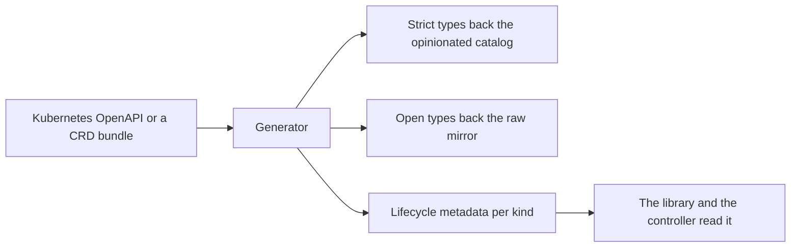

# 0005 design: Kubernetes-Native Refocus: Generated Mirror and Composed Abstractions

## How it works

One generator reads the OpenAPI of one Kubernetes minor, or a bundle of CRDs. It writes the same kinds twice, once with closed types and once with open ones, and stamps each kind with its lifecycle facts. The catalogs stop keeping their own schemas, and the controller gets its ordering as data.

The entry states stances and no requirement lines. The shapes a consumer would observe rest on five open questions in the proposal, and none has a decision yet.

## Design

### One generated source of Kubernetes types

The Kubernetes OpenAPI is the single source of Kubernetes type truth. Generation tooling derives every downstream schema from it, and both catalogs consume the output. Neither keeps a schema of its own, so the two cannot drift.

The project targets Kubernetes only, and Kubernetes is the lowest common denominator both catalogs already reach. Other platforms are not excluded, but no abstraction is shaped to fit them. The only duplication that hurts is the divergent schema foundation, and one shared source removes it without coupling the catalogs to each other. The measurement behind this is in `evidence/decision-log.md`.

Pointed at a CRD bundle (cert-manager, Flux, Gateway API, an operator), the same generator emits a typed catalog for it. The long tail of CRDs becomes first-class without a hand-written transformer each. A generation manifest names the inputs, the rendering and the output targets, so a regeneration is reproducible and the catalog source is a build artifact.

### Two renderings of the one source

The strict rendering closes the types. The opinionated catalog builds its constructing transformers on it, and it is where validation is wanted. The open rendering leaves every leaf open, so the raw mirror accepts any valid native field and keeps pass-through fidelity.

The raw mirror is generatable because its pass-through transformer is uniform across kinds. Only the group, version, kind and scope differ, so it is a template. The generic `#Objects` escape hatch stays for anything the generator has not typed. Whether the two renderings are two modules or one module with both per kind is open, and so is whether the strict side reuses `cue.dev/x/k8s.io@v0` or is generated in-house.

### Lifecycle metadata on every kind

Each generated resource carries a block with four facts: scope, apply phase, readiness and prune policy. Scope comes from discovery, so a cluster-scoped kind gets no namespace injected. The apply phase turns today's hardcoded order list in the library into per-kind data. Prune policy is ownerReferences plus server-side apply field ownership, which the Kubernetes-only target makes concrete.

Readiness is the one fact the OpenAPI does not carry, because it encodes status conventions. It is curated per kind, with a generic fallback on a `Ready` condition. The curated table is data with its own review, not code. Who owns it is open.

The block is shaped so the library and the controller read it without re-deriving anything from the group, version and kind. The controller uses it for ordering, readiness reports and pruning. A controller that finds no block, from an older catalog, must degrade gracefully.

### An abstraction keeps an escape hatch

The opinionated catalog keeps its own constructing transformers, now pointed at the strict generated types. Each blueprint gains an override: sugar sets defaults, and the author overrides any native field of the resource it produces. The author who needs a field the shorthand hides keeps the blueprint and sets that field. The full type sits behind the abstraction, so the abstraction layers on the resource and does not hide it.

For an override to win, the projected sugar fields must be defaults. A concrete assignment, as in today's stateless workload blueprint, would make the override conflict. Whether the trapdoor is a patch unified on top or an explicit `overrides` field merged into the output is open, and it blocks acceptance.

### Catalogs compose on top, never underneath

Composition between catalogs is a supported capability. A third-party catalog can publish golden-path templates that depend on the opinionated catalog or on the raw mirror and project onto their resources in pure CUE. The stateless workload blueprint already works this way: it composes a container resource and several traits and projects its own field onto their specs.

The base catalogs are not required to compose each other. The opinionated catalog does not render through the raw mirror, because passing a spec through and building a spec from sugar are different jobs. Composition happens above the base catalogs.

### Core does not change

This entry changes nothing in core. A transformation stays single-pass: a transformer matches on the resources and traits present in a component, and there is no chaining. The generated catalogs, the tooling and the adapter in the library and controller carry the whole change.

A separate core entry for multi-phase lowering, where transformer outputs go back through matching, opens only when a concrete case shows that pure-CUE projection cannot express it. The transformer-output convention stays compatible with typed outputs later, so that case does not force a rework of the catalog APIs.

### Rollout in one order

Each hand-off is a published catalog tag that the next repo pins. The order is: tooling that emits both renderings; the mirror regenerates and publishes; the opinionated catalog re-points at the shared strict types and publishes; the library reads the apply phase and readiness; the controller reconciles on the metadata; the site documents the workflow.

Old hand-written sources are deleted and not aliased. The library's order list is replaced by the per-kind phase. Rollback is a re-pin to the last hand-written release, since consumers pin catalog versions and core is untouched. The generator runs at build time, so reverting it has no data-plane effect.

The old text called a tightened schema a breaking minor, absorbed by a pre-1.0 cadence. The catalogs have since moved to major versions (`evidence/decision-log.md` names `opm@v4` and `k8s@v1`), so that argument does not hold as written. Whether the entry is breaking is for the owner to settle at accept.

## Risks

- **Closed types over-constrain real manifests.** The mirror stays on the open rendering, strict types serve only construction, and `#Objects` stays for the untyped.
- **The curated readiness table goes stale.** A generic `Ready` fallback covers uncurated kinds, and the table is reviewed as data.
- **Regeneration lags a new Kubernetes minor.** Catalog releases align to minors, and regeneration is part of the release flow.
- **A trapdoor that conflicts instead of overriding.** Settle the unification question before construction starts.
- **Projection hits its limit mid-way.** The output convention stays multi-phase friendly, and a trigger case is tracked.
- **A new generation pipeline to own, and two renderings to keep coherent.** Accepted, because hand-authoring cannot reach every kind, version or CRD.
- **Catalog contributors patch the generator, not the CUE.** A workflow change for catalog authors.

## Considered and rejected

- Considered keeping hand-written schemas in the mirror and independently vendored types in the opinionated catalog; rejected because two sources drift silently and hand-authoring does not reach every kind, version or CRD.
- Considered a platform-neutral abstraction spanning Kubernetes and other runtimes; rejected because the project refocused on Kubernetes and neutrality costs generality for runtimes out of scope.
- Considered forcing the opinionated catalog to project onto the mirror, so the pass-through mirror does all rendering; rejected because it adds indirection without removing real duplication and makes the trapdoor harder.
- Considered delivering multi-phase lowering now; rejected because it is the largest risk to the kernel and the shared source plus optional composition already remove most of the pressure.
- Considered designing a sibling core entry in parallel from the start; deferred, not rejected, until a sequential-lowering case appears.
- Considered keeping only the generic `#Objects` hatch for CRDs; rejected because it gives no typing, validation or lifecycle data and cannot back a typed abstraction.
