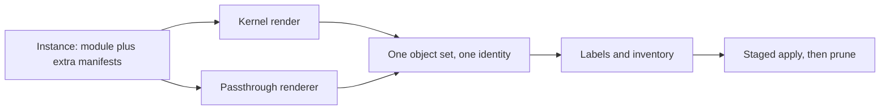

# 0007 design: Manifest Passthrough

## How it works

Today every object that reaches the cluster is a typed component matched by a transformer. The CLI and the operator already share one end product: a list of Kubernetes objects, and one managed path that labels, records, applies and prunes them. Raw YAML and Kustomize output are more objects of the same kind. So passthrough reads the declared sources, joins their objects to the rendered list, and lets the existing path do the rest.

## Design

### Passthrough lives in the apply layer

The CLI and the operator carry the feature. The core schema and the library kernel do not change. A side manifest never becomes a component, a resource or transformer output, and a module cannot declare one. A module that is valid before this change is valid and unchanged after it.

The reason is the kernel's purity: it does no file access, runs no command and executes no code. Kustomize reads a filesystem and can execute code, so it cannot live there. The apply layer already talks to the cluster and the disk, so the cost of the feature stays in one place. The kernel's render never contains a passed-through object. Side objects join the set only after render.

The price is that the CLI and the operator each wire the same renderer into their own apply path. A shared renderer package keeps the two from drifting.

### The declaration is a side field

An instance is one deployed copy of a module: the operator's module instance or package, or the CLI's instance input. An instance declares extra manifests in a field of its own, beside the module and apart from its components. The field is an optional list. Each entry is a raw path or a Kustomize directory, and exactly one of the two. An entry that names both or neither is rejected. An empty list, or no list, is valid and changes nothing.

A path resolves inside the instance's own source tree and never outside it. For a package the operator already extracts a Flux artifact with a size cap and a digest check, and that tree is the root. For the CLI the root is the folder of the instance file. A module instance has no such tree, and its root is an open question.

The side field keeps the typed path and the untyped escape hatch visibly apart. A reader sees at once that these objects are off the typed path and carry none of its guarantees.

### Kustomize runs as a library

The renderer embeds the Kustomize build library and never runs a `kustomize` binary. The version is pinned in the Go build. The CLI and the operator render the same input the same way. The options are set in code, so exec plugins are off by design and no binary default decides it.

The cost is small on one side and one module on the other. Measured on 2026-09-29, the operator at `8529e00` already lists the Kustomize library as an indirect dependency, and its apply package reaches the build library through Flux and the CLI runtime. The CLI at `e9a9e4e` names no Kustomize module, so it gains one. Whether Helm inflation is off as well, and whether a trusted mode exists, is an open question.

### Side objects join the rendered set

Passed-through objects join the rendered list before labelling, inventory, staging, apply and prune. From there on nothing tells the two kinds apart.

- A side object carries the same ownership labels as a rendered one, including the instance identity.
- It is recorded in the same inventory. There is no second inventory.
- It is pruned the same way when it leaves the declared set or when the instance is deleted.
- It is staged in the same order, so a side custom resource definition or namespace lands before what depends on it.
- It carries a marker that says it came from a declared source and which kind. The marker rides on the existing provenance slot and exists for observability and targeted diffs.

Prune keeps its ownership guard: it deletes only objects that carry the managed-by label and a matching instance identity. A side object is prunable only after OPM stamped and recorded it. What happens when a side object collides with a rendered one is an open question.

### Both drivers, one result

The same declaration yields the same object set whether the CLI builds and applies it or the operator reconciles it. The CLI's build output includes the side objects beside the rendered ones. An instance tried from a laptop behaves the same once a controller owns it.

### Failure, rollback and order

A render failure of a side source (a missing path, malformed YAML, a Kustomize error) is atomic. The operator reports it on the instance's conditions with the path and the Kustomize error, and the CLI exits non-zero before it applies anything. Nothing is partly applied.

Rollback of the code is clean, and an instance without the list is unaffected. An instance that used the list has a caveat. After a rollback the operator no longer renders its side objects, so the next reconcile treats them as stale and prunes them when pruning is on. An operator who rolls back removes the declaration, or turns pruning off, on purpose first.

The order is: the shared renderer first, then the operator, which proves the whole ownership story, then the CLI, which can follow in parallel once the renderer exists. Core and library do not land, and their non-involvement is itself a checked outcome. No published artifact passes between the repos.

## Risks

- **Kustomize inside a reconcile loop.** Exec plugins, Helm inflation and generators that read files could turn an apply into code execution or non-deterministic output. The embedded library lets the options be fixed in code.
- **Pruning the wrong object.** A side object with the same kind and name as a foreign object could be adopted and later deleted. The ownership guard stays, and the collision rule must forbid silent adoption.
- **The CLI and the operator drift.** Different Kustomize versions or option sets would render the same declaration differently. One renderer package with one pin prevents it.
- **Path escape.** A path with parent segments could read outside the source tree. Paths are resolved against the root and an escape is rejected.
- **A second, untyped door.** The split between typed and untyped objects is permanent and authors must understand it. This is accepted as the cost of an adoption ramp.
- **Module instances may lag.** If the first cut leaves module instances out, they have a smaller feature until a later slice.

## Considered and rejected

- Considered a core schema primitive for side manifests (a component kind or a field on the module); rejected because it puts a Kubernetes and Kustomize concept in the platform-neutral core and forces a schema version discussion for no gain in expressiveness.
- Considered rendering Kustomize inside the kernel; rejected because the kernel does no file access or execution.
- Considered running a `kustomize` binary from the path; rejected because versions differ between machines, the operator image gains a runtime dependency and the process surface grows.
- Considered a separate inventory or a second ownership scheme for side objects; rejected because it recreates the orphan and drift problem the change exists to remove.
- Considered applying side manifests without pruning them; rejected because they leak when the instance is deleted.
- Considered making the feature operator-only; rejected because the CLI is a first-class apply path and the two would surprise users by differing.
- Considered attaching manifests to a component; rejected because it ties the side channel to the typed model and to the core schema.
- Considered Flux's own Kustomization object next to OPM; rejected because it yields two ownership and prune models on one cluster.
- Considered typing the objects inside the CUE pipeline (enhancement 0005); rejected as a substitute, because it still means authoring in CUE and has no overlay semantics. It may stay complementary.
