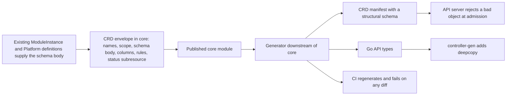

# 0008 design: CUE-Native CRD Schemas as Single Source of Truth

## How it works

Core holds one envelope per custom resource. The envelope wraps a domain definition that already exists with the CRD's own metadata, and it invents no schema. A generator downstream of the published core module emits the manifest and the Go types. Everything right of the published module is derived, so the CUE is the only file a person edits.

## Design

### One authored definition, in core

The `ModuleInstance`, `ModulePackage` and `Platform` types are written once, in CUE, in core. The controller's Go structs and its CRD manifests become generated output. This makes the running system match the stated model, in which core is the source of truth every consumer reads. Core already requires every `spec` surface to be OpenAPI-compatible, so non-CUE readers can use it.

The generator is a Go tool in the controller. It imports the published core module, the same artefact the kernel loads, so the generated types match what the runtime evaluates. Core stays pure CUE, with no Go and no build-time codegen. A shared generator repository is deferred, not rejected: it waits on whether the CLI ever regenerates on its own.

### The schema body comes from the CUE encoder

Each version's `spec` and `status` schema comes from CUE's OpenAPI encoder with references expanded. That is the structural form a CRD requires. The encoder emits only the schema body. It writes no CRD wrapper, no subresource, no printer column and no vendor extension, so the generator assembles those.

The domain definitions are not rewritten. The envelope refers to them, so each field has exactly one definition. A recursive value cannot be expanded and a structural schema forbids references, so a recursive field fails generation with the path named. None of the three kinds is recursive today.

### Facets are CUE data

Scope, short names, the status subresource, printer columns and validation rules are fields on the envelope. The generator splices them into the manifest. They are no longer kubebuilder comments. The shapes mirror the markers one for one, so the three existing CRDs can be re-expressed and checked. A scope, a column type or a rule outside the allowed values fails when core evaluates, long before a manifest exists.

The envelope is new to core and amends no live entry. The compilable shapes and the two worked instances are in `evidence/schemas/`. A `ModulePackage` instance waits on the open question about its core definition.

### CEL passes through as text

A validation rule is stored as a string and injected into the manifest unchanged. Today the only rule is the `Platform` singleton rule, which allows the name `cluster` alone. Core never parses, evaluates or derives a rule. The CUE maintainers call the translation a big lift, and CEL transition rules compare old and new objects, which stateless CUE cannot express. A rule that names a renamed field fails only at apply time. That cost is accepted.

### Deepcopy stays with controller-gen

The generator writes Go structs with their json tags and the root marker. controller-gen then writes the deepcopy methods over them, as today. Only controller-gen produces them, and it reads Go, not CUE. The generator owns struct emission behind its own boundary. It may call the experimental CUE command or use a small emitter of its own. Either way the project does not depend on that command staying stable or on its exact output, which turns a union into an untyped value. Behind the boundary the generator can emit a named string type for an enum.

### A regenerate-and-diff gate blocks drift

CI regenerates the manifests and the types from core and fails on any difference from the committed files. Regeneration is also a local task. The gate is the point of the entry: drift becomes impossible to merge, not merely discouraged. Committing the output keeps the diff reviewable and lets consumers build without the generator.

### What the author does

Before, a change to a resource meant editing the CUE in core, editing the Go in the controller, running controller-gen, reviewing both and hoping they agreed. After, the author edits the CUE in core and publishes it. In the controller one task regenerates the manifests and the types, and the author commits the result. CI repeats the task and blocks the merge if the committed output is stale. Adding a new resource means writing an envelope value instead of Go structs with kubebuilder markers, which is the main thing a contributor has to learn.

### What goes wrong is named at build time

The runtime is unchanged: the same CRDs, the same controller conditions and events. The new signals are for developers. The generator names the CUE path of any construct it cannot express as a structural schema. The CI check prints the difference between the committed and the regenerated files. An admission test that applies each generated CRD to a real API server catches a schema rejection at generation time, not on a user's cluster. The one change a user sees is better: a bad spec fails at `kubectl apply` with a structural-schema message, not later as a CUE evaluation error in the reconcile.

### Rollout

Core publishes the envelope first. The controller then bumps its core pin, adds the generator, regenerates the types and manifests, and wires the gate. The CLI bumps the controller dependency and rebuilds with no source change. Each hand-off is a published version pin, so each step is reviewed alone. The hand-written structs are deleted in the release that lands the generator, with no transition window. Rollback is a revert of the controller change. The regenerated manifests match the shipped ones for unchanged fields, so a cluster needs no change. Stored resources are untouched either way.

## Risks

- The encoder targets generic OpenAPI and the structural subset is stricter, so a CRD it emits could be rejected. A spike against the real core module and an admission test against a real API server answer this before accept.
- Regeneration could silently change a live CRD: field order, descriptions or nullability. The unchanged fields must match the shipped manifests apart from formatting, and each deliberate difference is listed.
- A union becomes an untyped value in generated Go, which weakens the type. The generator emits named types for enums and leaves an untyped value only for a true JSON passthrough such as `values`.
- The generator and core can drift in version. The generator pins the core version the controller's kernel uses, in one place.
- A new tool must be kept working across CUE and controller-tools upgrades, and authors must learn the envelope in place of kubebuilder markers.

## Considered and rejected

- Considered Go as the source of truth with CUE derived from it; rejected because it makes core a derived artefact of the controller, which inverts its role as the published contract.
- Considered the CRD YAML as the pivot with Go and CUE derived from it; rejected because there is no first-class path from a CRD to Go, so the types would be orphaned.
- Considered codegen inside core; rejected because core is a pure-CUE module and a generator would break its rule and its publish workflow.
- Considered a standalone shared generator repository; deferred until a second consumer needs to regenerate.
- Considered the JSON Schema encoder for the schema body; rejected because it emits only the 2020-12 dialect, which is the wrong one for a CRD.
- Considered hand-written schema bodies; rejected because they defeat the single source.
- Considered keeping kubebuilder markers on the generated Go; rejected because regeneration overwrites them and the CRD would split across CUE and Go comments again.
- Considered a separate YAML overlay merged at assembly; rejected because it adds a second authored file.
- Considered generating deepcopy from CUE; rejected because no tool reads CUE for it and writing one is out of scope.
- Considered deriving CEL from CUE constraints; rejected because the translation is unbounded and transition rules cannot be expressed.
- Considered the experimental CUE command as the only Go emitter; rejected because it may change or vanish and it loses enum typing.
- Considered review and discipline alone to keep the copies aligned; rejected because that is today's failure mode.
- Considered generating at build time and never committing; deferred, see the open question.
- Considered adopting timoni or Holos wholesale; rejected because they all convert CRDs to CUE, the opposite direction.
