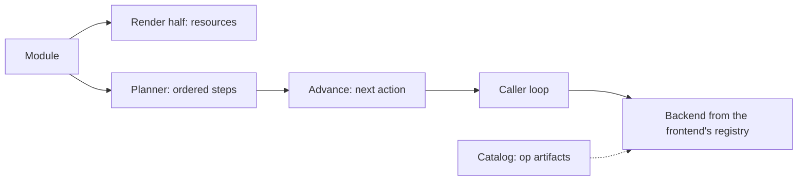

# 0009 design: Operational Primitives

## How it works

One module has two readers. The render half emits resources, as today. The planner turns a lifecycle phase or a named workflow into an ordered plan. The library advances that plan one step per call, and the caller performs each action through a backend it chose.

## Design

### A second half over the same module

The kernel gains an execution half that reads the same module as the render half and produces a plan, not resources. One input, two interpreters. Rendering stays untouched, and a module with no operational declarations behaves as it does today.

Operations are not rendered as Jobs through the transformer pipeline. That would give the render half sequencing it has no model for, and it would blur what must exist with what must happen. The execution half is additive and reuses the parsed module.

### Four constructs, a closed vocabulary

Core gains four constructs. An `#Op` is one step. An `#Action` composes steps and nested actions, and carries an identity derived from its module path, name and version so a catalog can publish it. A `#Lifecycle` binds steps to phases. A `#Workflow` is an on-demand flow, addressed by name inside its module.

Composition is open and the vocabulary is closed. OPM owns the set of step kinds, and an author cannot invent one. That is the structural defence against the Helm failure, where the escape hatch becomes the front door. A step orders itself only against sibling steps in the same map.

A lifecycle has nine fixed phases: before, during and after for install, upgrade and uninstall. A closed set lets the operator drive transitions from its reconcile loop. Steps in a phase run in authored order. An absent phase does nothing. Phase-triggered and on-demand flows differ in trigger and in state, so they stay two constructs.

### The library plans and advances, the caller acts

Given a plan and a run state, one advance returns the next state and at most one action. It runs no loop, performs no side effect and keeps nothing between calls. The caller performs each action and owns the state. The state must survive serialisation, so a controller can carry it in a custom resource across reconciles.

Every rule about what happens next stays in the library: which steps are eligible, in what order, what satisfies a step, what a failure does, and when a plan is complete. Two frontends with the same plan, state and result get the same answer. This follows library ADR-008: the kernel decides and the caller acts.

The shape also settles cancellation between steps. A caller cancels by not calling again.

### Dispatch by attribute, backends by choice

Each concrete step kind carries an `@op(...)` attribute on its discriminator field. It names a protocol, which picks a backend, and a locator for the executable artifact. CUE evaluation ignores the attribute, so the value stays clean, and the Go SDK reads it. CUE does not allow an attribute before a field, so the attribute sits after the value. The dated research in evidence finds no removal of attributes planned, and CUE's own custom functions use them.

Backend hosts live in the library's opt-in tier, the boundary a frontend may skip. A frontend registers only the backends it wants. The whole plan is checked against that registry before the first action, so a step with no backend fails fast, naming the step and the protocol. That is how the operator declines ad-hoc container builds. The same plan runs differently per frontend: an exec step runs a local container on the CLI and renders and watches a Job under the operator.

### Operation code comes from the catalog

The code a step runs is not compiled into the library. It is an artifact located by the attribute, and it travels the rails transformers use. Core's `#Catalog` gains `#ops` and `#actions` maps beside `#transformers`, keyed by identity. A platform gains an operation by subscribing a catalog that publishes it. The library owns the mechanism and the catalog owns the behaviour.

The initial vocabulary is exec, http, wait, cue.eval and Kubernetes get and apply, published by catalog_opm. The http step accepts the five verbs and returns the raw status, headers and body. Parsing happens downstream in CUE, which keeps the executor a thin transport.

### Attachment on a module aspect

Lifecycle and workflow declarations attach through a module's aspect map, as module traits that a catalog publishes. There is no per-component attachment and no dedicated field on the module. The execution half reads them from the same aspect the render half sees. No render-side transformer handles them, so the render emits nothing for them and reports no missing transformer.

This leans on enhancement 0025, which defines aspects and module traits. Enhancement 0025 also answers how a non-resource trait counts as fulfilled. None of the requirements here amends another entry, so all are ADDED. Enhancement 0012 declares that it amends the decision on where backends live, because its Kubernetes tier sits beside the kernel and not under the opt-in tier. That line is 0012's, so the requirement here stays ADDED.

### Cancellation and the injection surface

The kernel dropped its logger, tracer and clock slots because nothing read them. This half introduces the injection surface the planner needs, together with its first reader, in whatever shape that reader dictates. It does not restore the removed symbols.

Cancellation inside a stage is also this entry's. A check of the caller's context at a verb's entry and between its stages reaches no stage, so it landed on its own, ahead of this entry. What is left is cancellation inside one advance. A running CUE evaluation has no cancellation hook, and CUE's loader replaces the caller's context before any registry fetch. The only seam is the registry interface of the load configuration. The open question on how far cancellation reaches covers the rest.

## Risks

- A closed vocabulary that is too small pushes authors to a raw exec step. Mitigate it with a useful starting set, ready-made actions, and catalogs that grow the vocabulary.
- Remote artifacts are a supply-chain surface. Favour sandboxed WASM by default, let frontends refuse classes of execution, and pin and sign artifacts as catalogs are.
- Side effects could leak into the planner. Keep the planner and advance free of I/O, as in the render half.
- Lifecycle steps could re-run on every reconcile. Lean on convergent executors and completion records. Workflows stay on demand, apart from the reconcile path.
- A mismatch between the attribute grammar and the planner fails silently. Validate the grammar and test that every shipped step kind parses to a registered protocol.
- Everything depends on CUE keeping attributes. The research finds this low risk.
- A second execution model is real surface to learn and test. The payoff is pluggability without library releases.

Order of landing: core, then library, then catalog_opm, then cli and opm-operator, which land independently. Rollback is cheap: a module without operations behaves as today, and a frontend with no backends cannot run flows. Side effects already performed are not undone.

## Considered and rejected

- Considered rendering operations as Jobs through the transformer pipeline; rejected because the render half has no sequencing model.
- Considered a separate tool outside the kernel; rejected because the CLI and operator embed the kernel.
- Considered one operation construct with a mode flag; rejected because lifecycle and workflow differ in trigger and state.
- Considered defining the constructs in a catalog; rejected because every consumer types against them, so core is their home.
- Considered a library that walks the whole plan behind an injected executor; rejected because a blocking loop is a process model, and a controller reconcile must return promptly.
- Considered a plan emitted once with each frontend writing its own walk; rejected because the sequencing rules would live in two places and drift.
- Considered backends in the kernel core, or entirely outside the library; rejected because they would force every runtime on every frontend, or leave the executors outside the library.
- Considered a regular CUE field for dispatch, or compiled-in implementations; rejected because dispatch is runtime metadata and every new operation would need a library release.
- Considered author-defined phase names; rejected because a closed set lets the operator drive transitions.
- Considered a typed HTTP step that decodes JSON; rejected for now because shaping belongs in CUE.
- Considered attaching per component, at both levels, or as a dedicated module field; rejected because a workflow spans components, and a field per feature is what aspects stop.
- Considered Helm-style hooks; rejected because an arbitrary script as a hook is the failure this entry avoids.
