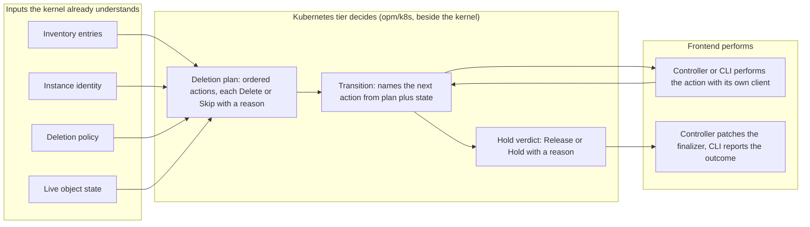

# 0012 design: Kubernetes as a First-Class Library Tier

## How it works

The tier computes an ordered deletion plan from four inputs. Each action is a delete or a skip with a typed reason. The tier names the next action from the plan and the outcomes so far, and then gives a verdict on whether the hold may be released. A frontend performs every action with its own client and keeps credentials, the reconcile loop and the finalizer patch.

## Design

### One tier for every Kubernetes decision

Inventory entries, the stale set, digests, prune safety exclusions, ownership guards at apply and delete time, deletion order and the deletion hold live in the library. Neither frontend keeps a private implementation. Kubernetes is the library's one platform, so the tier is written against Kubernetes concepts with no neutral layer. The earlier neutral resource contract, which had no implementation, is already deleted. `k8s.io/apimachinery` enters the library module for the tier only.

This replaces the placement conclusion of entry 0006, which removed a shared package. Its data-flow analysis stands, and 0006 stays implemented. Two of its three supporting facts changed: both frontends now pin one library version, so the module edge it priced is paid, and its objection to a third representation aimed at a neutral type that no longer exists. The defects it missed were single-actor ones, invisible to a cross-actor argument.

### The tier is fenced and mandatory

The tier sits beside the kernel, not inside it and not under the opt-in helper tier, in the library's one Go module. The kernel imports no Kubernetes package. The tier imports only the kernel's exported packages and `apimachinery`, never a client, controller or Flux package. Lint holds the fence before the first tier package exists.

The tier is not opt-in. A frontend that adopts a package deletes its copy in the same release, leaves no alias and refuses a reintroduced copy in its own checks. No library code drives a plan to completion or performs a planned action against a cluster, so the kernel takes no cluster client.

This amends entry 0009's rule on executor backends. Its hosts that perform no planned action against a cluster stay opt-in. Its Kubernetes get and apply operations and the container host's Job variant belong to the frontend. The amend is prose here: 0009 is a live entry with no shipped requirement to modify, so every delta is ADDED and 0009 is in `after`. The nine requirement lines that name Go packages or hold a library-internal rule are in `evidence/cut-requirements.md`, for the library, the CLI and the controller to carry.

### Deletion is a protocol and apply is a verdict

The library owns the whole deletion sequence: the plan, each transition and the hold verdict. Deletion carries no framework opinion, so nothing stops this. The state is a serialisable value the caller holds, and the protocol runs no module hooks.

For apply the library owns the per-object verdict and the order, not the engine. The controller keeps Flux server-side apply and the CLI keeps its own. An engine may refine the library order within a stage and never contradicts it. The CLI's build gains no Flux or controller package.

### Ordering is kind-class order

One weight table in the tier orders objects by Kubernetes kind: a CRD before its resources, a Namespace before its contents. No module-internal ordering is planned, and Kubernetes' eventual consistency settles the rest. Order between modules belongs to a future Bundle definition, which this entry does not design.

### Labels come from CUE

The CUE render stamps every OPM label, and the frontend fills the runtime name. Go code reads labels and never stamps them. The render digest has one definition and ignores the value of the managed-by label, so both frontends digest one render to the same bytes.

### The inventory has one identity

The stale set is component-blind: an entry is the same object as a rendered one when group, kind, namespace and name agree. The CLI's rename filter goes with no change in behaviour. The inventory digest hashes a canonical field-by-field encoding, so it no longer depends on either frontend's JSON. Each frontend changes its stored digest once and says so in a migration note.

### The apply guard runs every time

The guard judges every object on every apply, because an object set grows across releases. A live object outside the inventory that OPM does not manage, or that carries another instance's identity, is refused with a reason. The one override is per object: the user sets `opmodel.dev/adopt` to the adopting instance's UUID. Neither frontend sets it.

The same annotation hands an object between live instances. The instance it does not name refuses the object as adopted elsewhere, drops it from the inventory it records, keeps applying its other objects and never deletes the object. A UUID label alone never refuses an object in the inventory, so moving a module to a new registry path stays safe. A ModulePackage records its instance identity in an additive status field. The controller install admission of 2026-10-04 was withdrawn on 2026-10-09, because nobody runs OPM yet.

## Risks

- A second revert of the tier would burn both migrations. The replacement rests on named facts, not on the original argument.
- The `apimachinery` floor binds every embedder. Both frontends were on the same version on 2026-10-02.
- During migration the guards exist in three places. Each package and its first consumer land together.
- A library bug deletes in both tools. The tier needs better tests than either frontend had.
- A principal with patch rights can set the adopt annotation and make an instance let go of an object. No owner accepts this risk yet.
- Owner references could land and silently break `prune: false`. The first open question blocks accept for that reason.

## Considered and rejected

- Considered documented conventions in place of shared code; rejected because two such questions in 0006 stayed unimplemented.
- Considered the shared package in a fourth repo or the controller; rejected because the controller's types drag its framework into the CLI.
- Considered reference-only shared code; rejected because code nothing imports misleads.
- Considered keeping a neutral resource contract under Kubernetes; rejected because it had one implementation and no consumer.
- Considered the tier inside the kernel or under the helper tier; rejected because the kernel stays free of Kubernetes and the helper tier is skippable.
- Considered a nested Go module for the tier; rejected because it adds a release hop and version skew.
- Considered adding the fence after the first package; rejected because a package can gain a forbidden import first.
- Considered a library apply engine; rejected because Flux must not reach the CLI.
- Considered verdicts only for delete; rejected because a plan a frontend can decline is how the CLI lost the CRD exclusion.
- Considered deletion under 0009's execution half; rejected because 0009 is parked and deletion needs no hooks.
- Considered module-declared ordering; rejected because no module asked for it.
- Considered the library stamping labels in Go; rejected because it splits the label set.
- Considered keeping the managed-by value in the digest; rejected because the two digests could never agree.
- Considered component-aware identity or JSON hashing; rejected because each needs a rescue rule or ties the digest to a serialisation.
- Considered a guard on the first apply only; rejected because later releases add objects.
- Considered a command-wide force flag or no override; rejected because the first takes objects the user did not mean and the second forces a delete first.
- Considered install admission and an controller-namespace override; rejected, one withdrawn and one too broad.
- Considered refusing in-inventory objects by UUID label alone; rejected because a registry path move would refuse every object.
- Considered stopping the whole apply on adopted-elsewhere; rejected because the inventory would never drop the object.
- Considered a cross-repo conformance suite, folding the CLI into the controller, or CUE-generated logic; rejected as symptom fixes, a lost workflow and the wrong home for logic.
