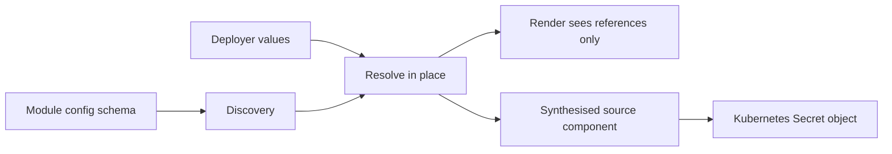

# 0013 design: Attribute-Declared Secret Fields

## How it works

The schema declares every secret, and discovery lists them. Resolve gives each group one object name, rewrites every secret to a reference, and sends the plaintext to a synthesised component of the chosen source. The plaintext and the render meet again only inside the object that stores the value.

## Design

### A secret is declared once

The author types a sensitive config field as the secret type and may add an `@opm(secret, ...)` attribute. The attribute carries routing, which is static and the same in every environment: group, key, Secret type, immutability and description. Every argument is optional. The type carries fulfilment, which belongs to the deployer and which CUE itself type-checks.

The author knows which fields are sensitive. The deployer knows where the data lives. A literal is written `{value: "..."}` and a reference `{ref: "...", key: "..."}`. Both are structs, so a module with either arm validates alone and instance files that supply a literal keep their shape.

Core is the only definition of the type, its arms and the named types for a Secret key and a Secret type. Catalogs import them. The old vocabulary (the `$`-prefixed marker fields, the discovery pyramid, the content-hash and name helpers) is deleted with no alias, because the two shapes cannot coexist on one field.

### The schema declares, discovery finds

A field is a secret because the module's config schema says so, never because a value says so. Each arm of the secret type carries a hidden tag that only core can write. Discovery follows aliases, embeddings, patterns, lists and disjunctions to the tagged arms, so it finds every form a module can declare and nothing that merely looks like a secret.

Discovery runs twice. Before values exist it lists every declaration it can reach, which feeds the skeleton values file and inspection. At render it walks the schema with the values unified, so conditions resolve and patterns expand to concrete paths. A declaration under a condition on a deployer value is invisible until values select it.

Discovery fails closed. A field typed as the secret type with no attribute is discovered with default routing. An attribute on a field that is not typed so is an error. Forgetting the attribute can never leak a literal. A declared path whose resolved value is not a core secret, such as an unset plain default or the shape of the earlier core release, is refused by name.

### Secrets resolve in place

Before the component graph is built, the kernel rewrites every declared secret to the reference form, whichever arm the deployer wrote. A literal becomes a reference to the object the kernel decided to create. A reference passes through unchanged. After that nothing downstream can tell the arms apart, and a transformer reads two fields from one branch.

The render build omits the deployer's original values. It never overrides them, because a literal and a resolved reference collide under the closed arms, and that collision is the structural proof that omission is the only way. The raw values are validated in their own evaluation, so one graph build is enough. The rewrite works on evaluated data: decode, splice, encode. The deployer's file is never touched.

Plaintext reaches no rendered manifest except the Secret that stores it. A module that interpolates a secret into a string fails in CUE's own vet at authoring time, because a struct does not unify with a string. An authored instance package refuses a literal, since the kernel can only keep plaintext out of a build it assembles itself, and such a package sits in version control or a registry.

### One object name per group

The kernel computes each Secret object name once, from the instance and the group, and writes it into the resolved value. Every consumer reads that one string, so an environment variable and a volume cannot disagree. A group whose members disagree on type, immutability, source or settings is refused, naming the group and each member path.

An immutable group carries a content hash in its name, computed before the rewrite, so every reference already holds the suffixed name and follows the object when the data changes.

### Sources are catalog resources

A secret method (a plain Secret, a sealed one, an external store) is a resource a catalog defines and the platform installs. Several can sit side by side. The deployer names the source per value by its exact contract name, apiVersion included. Nothing resolves a short name or picks a version, because OPM binds exactly everywhere else. A reserved annotation only marks a resource as a secret source.

The literal is sugar for the one source the platform marks as the literal source. A platform that defines two literal sources is refused as a platform, before any instance renders. The first-party catalog ships the literal source, and its Secret carries exactly the name the kernel computed.

Core defines the open arm and the input envelope once: a target, the group's settings and one entry per key. Core never names a method. Settings belong to the platform by default, are set once per installed source, and the source's own schema decides which a deployer may override. A platform fills them through its catalog entry, keyed by the catalog's exported definition so a version bump neither loses nor misapplies them.

Delivery has two waves. Wave one ships the literal and the reference, with the literal already going through the source machinery. Wave two adds the named-source arm, which only widens a union and breaks nothing.

### Mistakes fail loudly

Plain CUE validation of an instance rejects a value with both arms, a bare string, an unknown field or a wrong type, through a hidden check beside the values that adds no default to the exported values. Completeness is the kernel's check, on every entry path, because CUE does not check concreteness under a hidden field: an unfulfilled secret fails every render and every validation, read or not.

The component the kernel synthesises for a group is held to what an authored one is. Its entries are validated for completeness at the deployer's path, its name never equals an authored name, and a source with no provider refuses the render. The render reports every contract it required, synthesised components included, so a guard that protects contracts in use refuses to remove a source that an instance uses.

No diagnostic carries a value at a declared path or at a synthesised path. Every error keeps the path and the reason and replaces the value with a fixed placeholder, in the kernel, so every frontend inherits it.

### Encryption stays at the edge

OPM implements no cryptography. The CLI accepts a SOPS-encrypted values file and decrypts it before the values become CUE, so the kernel receives plain values. The CLI writes a skeleton values file from the module alone, and its module check reports unfulfilled secrets as one grouped message.

A literal inside an instance resource is accepted and documented as plaintext at rest in etcd, on the controller path and on the CLI apply path alike. A reference or a named source is the production answer. Encrypting the secret values of an exported instance for GitOps belongs to enhancement 0014's export surface.

## Risks

- **A mistyped attribute is invisible.** Discovery keys on the type as well as the attribute, and an unknown marker kind warns.
- **A module reads a resolved secret's value.** The kernel re-reports the error against the config path it wrote.
- **Migration touches a live cluster.** One rendered object name changes, and RBAC scoped by that name moves with it.
- **The platform settings carrier in the controller and the CLI is unmeasured.** The first delivery measures it.
- **Plaintext at rest in a resource.** Documented, with the reference as the production answer.

## Considered and rejected

- Considered a field typed as a plain string with no secret type; rejected because it leaves the deployer no slot to say a Secret already exists.
- Considered an opaque handle in place of the value; rejected because a struct value carries the object name and needs no side table.
- Considered a bare-scalar reference arm; rejected because the value's kind would change across resolution and modules would validate only with the kernel.
- Considered a context subtree filled by the kernel; rejected because authors would wire from a path that does not validate alone.
- Considered a shared base so the rewrite is a plain fill; rejected because plaintext would stay in the graph by convention.
- Considered a backend chosen for the whole platform; rejected because the right source depends on the data each deployer holds.
- Considered short source names resolved through the annotation; rejected because they break the day a catalog carries two apiVersions.
- Considered a values-from indirection on the resource; rejected because the reference arm already gives the production posture without it.
- Considered a SOPS arm or a SOPS backend; rejected because encryption is a property of the file.
- Considered a kernel plugin registry for backends; rejected because it needs a kernel rebuild.
