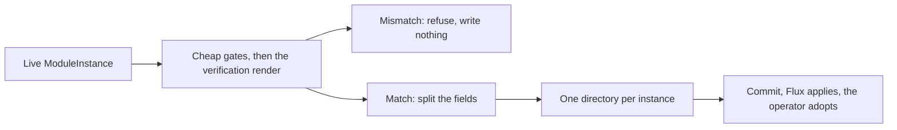

# 0014 design: Export a Deployed Instance as GitOps Manifests

## How it works

The export reads the live instance, runs a chain of gates from cheapest to dearest, and only then splits the fields and writes. The last gate re-renders the published module and compares its digest with the deployed one. The command then reports what it verified, completed and warned about.

## Design

### The export is the apply envelope

The unit is a directory, not a bare custom resource. It holds the instance, its namespace, the service account that applies it, that account's role binding, and a kustomization that lists exactly those four documents in apply-safe order. The directory applies into a cluster that holds only the operator, and it gives the same instance under the same applier identity with the same deletion behaviour. The shape is the one the demo bundle has today, generated instead of typed. Each document has its own file, because a generated tree is read as diffs, and a one-line role change must not touch the file that holds the values.

A bare custom resource is not enough. It names a service account that exists nowhere as a file, so the tree either fails to reconcile or runs under the controller's identity. The source object and the Flux kustomization are one per repository. Emitting them per instance would give N copies of a singleton that conflict on the first apply. The export therefore leaves repo-level wiring out and has no bare-resource mode.

The same input gives the same bytes. Running the export twice on an unchanged instance shows an empty diff, not churn. The module version keeps its `v` prefix, so the operator resolves the document without a second actor correcting it.

### Nothing is written unless the module reproduces the render

The export runs the preconditions the old handoff enforced, before any file exists. The gates run cheapest first: the cluster gates, the instance exists, the render did not come from local bytes, the module coordinate is concrete, a render digest is recorded, and a strict-registry re-render reproduces that digest. Any failure aborts with nothing written and names the reason. A forced export skips the digest comparison only. The local-render and resolvability refusals cannot be overridden, because the operator resolves modules from the registry and cannot reconcile one it cannot resolve.

The digest comparison is the guarantee. Its failure says the cluster runs something the registry no longer describes. The report states both digests and whether they matched or the comparison was forced. Committing the directory changes who applies the instance from then on. The export is the more consequential operation, so it must not be the less careful one than the handoff it follows.

### Fields are copied, completed or dropped

Render-bearing fields (the module coordinate and the values) are copied unchanged, and the digest gate verifies them. Apply-bearing fields decide who applies the instance and what a delete does. They sit outside the render digest, so completing them cannot weaken the guarantee. A CLI-written instance carries no service account name and no prune setting, so a dump applies as the controller and orphans its workloads on delete. The export completes both and names each completion with its consequence. For prune, the notice states the change from orphan to delete, not the field name. Cluster-side fields (status and server metadata) are dropped.

A render-bearing field is never completed or altered. This split is the reason completion is safe.

### Values are copied unchanged, with a warning

The values travel byte for byte, with a warning on every export that writes them: they went to disk unredacted, and OPM cannot yet tell which are secret. Redaction would break the digest guarantee, because a redacted document no longer renders to the deployed digest. A refusal needs a secret detector that does not exist until enhancement 0013 lands, and key-name heuristics are wrong in both directions.

Enhancement 0013 changes this. Three requirements moved here from 0013 and apply once it lands: the secret-bearing output can be SOPS-encrypted, the exported instance carries no plaintext secret value while every other field stays readable and diffable, and the decrypted instance renders as the unexported one. Discovery already yields the paths to encrypt, and Flux decrypts on the SOPS metadata, not the object kind. These requirements narrow the verbatim-copy requirement and the warning where a path is marked secret. They stay ADDED here, because the verbatim requirement is this entry's own and no delivered requirement changes. Until 0013 lands, the warning is the honest answer.

### The live instance is the only input

The export reads the instance from the cluster and nothing else: no local instance file, no values file, no overlay. The cluster object is what the operator reconciles and what the digest describes. A local file may have drifted, for example after an apply with overrides. A bulk export names one instance, or every exportable instance in a namespace or the cluster, and writes one directory each with nothing merged between them.

### Adoption is the success test

The exported instance carries the live name and namespace, so the first GitOps apply adopts the running instance. Success is the criterion of enhancement 0006: a reconcile in which the owned set is identical and nothing is pruned. The open risk is a third field manager. Flux applies onto fields the CLI and the operator already own, and a transfer that should be invisible once relabelled every resource. Only the runnable experiment in the open questions settles it. If the transfer is not quiet, the honest outcome is to document the expected change, not to claim a no-op.

### Where the work lands

Only the CLI changes. It adds the export command, reads one more field of the instance record, and lifts the verification render into a step both callers share, so there is one implementation. Core, library and the operator ship nothing. The operator's instance spec is the contract the exported document must satisfy, so a new field there must be added to the field split or it drops out of exports. The CLI reference on the docs site follows from the command definitions and does not gate the landing. The end-to-end case applies with the CLI, hands the instance to the operator, exports, applies the directory, and asserts that the inventory is unchanged.

## Risks

- **The first GitOps apply is not a no-op.** The open experiment gates acceptance, and the end-to-end case asserts an unchanged inventory.
- **A completed prune changes deletion behaviour.** Every completion is named with its before and after behaviour. A flag to keep the old behaviour is part of the first open question.
- **Generated roles are too wide or too narrow.** A cluster-admin binding spreads the demo shortcut, and a derived role fails on the first upgrade that adds a kind. The role document names its own limit.
- **Plaintext values reach a git remote.** The warning is unconditional and names the file. Enhancement 0013 removes the cause.
- **The CLI becomes a second applier.** An apply after the commit is reverted by Flux. The last open question covers it.
- **The gate blocks the case that needs it most.** An instance whose module no longer reproduces the render cannot be exported without a forced run. The operator cannot reconcile such a module, so the limit is accepted.

Drawbacks: a third representation of the instance now exists, the YAML values lose CUE typing, each export costs a registry round trip, and the first GitOps repository is part generated and part hand-written. Rollback is clean for the command, since it never writes to the cluster. Once Flux applies the tree, the way back is the usual Flux disown procedure.

## Considered and rejected

- Considered a bare instance only; rejected because its service account and namespace exist nowhere as files.
- Considered the envelope plus Flux wiring; rejected because the wiring is a singleton per repository.
- Considered a CUE-native export with a module package; deferred as a second mode, because it targets another operator path.
- Considered a best-effort scaffold with warnings; rejected because a warning cannot undo a file already written.
- Considered a separate check command after writing; rejected because a two-step guarantee can be skipped.
- Considered refusing unless plaintext is allowed; rejected because no reliable secret detector exists yet.
- Considered redacting values with placeholders; rejected because it breaks the digest guarantee.
- Considered exporting from a local instance file; rejected because it may have drifted from what runs.
- Considered a cluster object with a local overlay; rejected because the provenance would split.
- Considered teaching the operator to export itself; rejected because the verification render is a CLI capability.
- Considered documenting the manual procedure only; rejected because it makes the transcription no safer.
