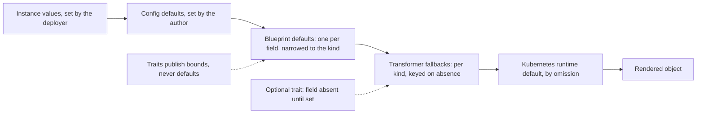

# 0017 design: Layered Defaults

## How it works

Read the chain left to right as a fall-through. A layer supplies a value only when everything to its left stayed silent. The last stop is Kubernetes' own default, reached by leaving the field out. The two dotted edges make the chain work. Traits add bounds and never a default, so they cannot collide with the blueprint. An optional trait leaves its field truly absent, which is what lets a transformer fallback fire.

## Design

### The order falls out of CUE

CUE unification does not remember which layer a value came from, so "the closest layer wins" cannot be written in the language. The design controls what each layer may contribute instead. Concrete data removes a marked default arm, so the author beats the blueprint. The kernel turns config defaults into data before composition, so config beats the blueprint. Absence falls through to the transformer. Instance values beat config defaults, which beat blueprint defaults, which beat transformer fallbacks.

A field that no layer above the transformer speaks for stays absent on the composed spec. The transformer's per-kind fallback, or Kubernetes itself, supplies it.

### Primitives publish bounds

A trait or resource schema never marks a default. It publishes the union of what any kind accepts, so attaching a primitive alone never makes a field concrete, and the catalog refuses a primitive that marks one. The default for a field depends on the kind, and a primitive cannot see the kind. A default there would also spend the field's single default slot, so no later layer could change it. For a trait that emits an object, a default would create a resource, such as a disruption budget on every workload, instead of picking a value.

The twelve unused `*Defaults` definitions of the first-party catalog are already deleted. They were the earlier answer to this question, and keeping them would document two conflicting mechanisms.

### The blueprint is the one defaulting layer

A blueprint is the highest layer that knows the target kind, so it holds both the legal menu and the starting value. It may narrow a composed field, but every value it admits must still be admitted by the primitive. It marks at most one default per field, always on a leaf, never on a whole struct. A whole-struct default fails when an author sets one field: the author's value removes the entire marked arm and silently drops the other defaults it carried.

With the author silent, the blueprint default renders. The author's concrete value wins. A value outside the narrowing fails at vet time and names the blueprint line. Whether the first-party workload blueprints keep a default for the update strategy for good is an open question in the proposal. The exhaustive per-kind audit belongs to catalog_opm issue 40. This entry sets the mechanism.

### The kernel finalizes config to data

After the kernel validates the deployer's values against the config schema, and before they reach the composition, it resolves every config default to its concrete value. The composition then receives plain data. This holds for instance values, for layered value sources and for the debug-values path used by frontends.

The change has one observable cost. A config default that breaks a downstream constraint used to be replaced silently by the disjunct that survived. A default of 80 meeting a constraint of above 1000 shipped 8080, which nobody chose. Now the default stays 80 and the conflict is loud and names the config field. A default is a commitment. It ships, or it errors. Finalization never creates a field that nobody set. The exact mechanism is an open question in the proposal and an experiment settles it.

### Core honours trait optionality

Core's component projection branches on the trait's stated posture. An optional trait contributes its field as a constraint that stays absent until someone sets it. A trait that is not optional contributes its field required, as today. Nested required and optional markers inside the schema value pass through intact.

A trait that never states a posture fails at every consumer. Today it is silently treated as required, and the posture field is a false promise: eleven of twenty traits force the author to set their field. The composed spec stays closed, so a typo is still rejected. A trait spec carries exactly one top-level regular field, which keeps the projection total. Core's existing trait gate and closedness already guarantee this, and the schema in the evidence pins it.

This makes the advisory posture from enhancement 0010 load-bearing. No requirement here modifies a shipped scenario of that entry. One requirement modifies the seeded render-parity closing rule, and the rest are ADDED.

### The contract is specification, enforced by tools

CUE cannot enforce the load-bearing rules, because each is a statement about which layer a value came from. Core's specification carries them as rules L1 to L6 with identifiers that CLI gates cite. This entry rewrites L5 from an author obligation into a kernel guarantee, because finalization makes the collision it warned about impossible. Enforcement splits by layer: catalog publish gates for the primitive and blueprint rules, module vet gates for the config rule, and transformer review for the last. Until the gates exist, the rules hold by review only. The rule data is in the evidence.

### Plain CUE stays the floor

Every valid module and catalog passes stock `cue vet`, and the kernel never silently differs from plain CUE. Two divergences are accepted, and each is loud on at least one side. A config default meeting a blueprint default exports as an incomplete value under plain CUE, and the kernel resolves it. A config default vetoed by a downstream constraint ships the surviving disjunct under plain CUE, and the kernel errors. A module that relies on the first renders in the kernel but not under plain export, so a module that needs export parity avoids it. A published helper cannot mirror the finalize step, because it is an evaluation-order choice and not a value. The render-parity rule that a divergence closes by removing kernel behaviour gains these two as exceptions.

### Order of landing

The default order is core, then the catalog, then the kernel in parallel, then the CLI, then the modules. Rollback is per repo: pinned releases are re-pinned and the kernel step is one revert. Nothing in the data plane changes. Whether the catalog may land before core is an open question in the proposal.

## Risks

- **Core's projection breaks a consumer that reads an optional field unguarded.** The catalog transformers already guard it. The change is breaking, and the catalog fixtures gain components built through a blueprint.
- **Default-as-commitment exposes latent conflicts in the module fleet.** A full-fleet render before and after treats each as a found bug.
- **Finalization drops absence or mangles a secret value.** The experiment gates acceptance.
- **Narrowing rejects values the fleet already uses.** A fleet-wide vet against the narrowed catalog runs before release.
- **The CUE closedness bug of the pinned toolchain trips on new blueprint conjunctions.** The catalog falls back to narrowing the type only.
- **The layer contract is discipline until the gates exist.** Review holds L1 to L4 meanwhile.

## Considered and rejected

- Considered one defaulting layer, the transformers; rejected because blueprints could not state a per-kind starting value and fresh modules would stay unrenderable.
- Considered CUE's per-file default priority; rejected because it is a prototype internal API with a documented soundness bug.
- Considered a default in the trait schema; rejected because it is a kind-blind global claim that spends the only default slot.
- Considered per-kind variants inside a trait; rejected because it moves kind knowledge into the kind-blind layer.
- Considered a whole-struct blueprint default; rejected because a partial override silently drops the other defaults.
- Considered demoting the trait's field to optional in the blueprint; rejected because unification keeps the stronger required marker.
- Considered fixing optionality in the catalog across all traits; rejected because core's trait gate forces the field regular at the source.
- Considered defaults alone with no projection change; rejected because undefaultable optional traits stay unattachable and fallbacks stay dead.
- Considered author discipline for the collision; rejected because it covers only strings and burdens every author.
- Considered no defined precedence; rejected because an avoidance rule is the weakest contract.
- Considered the status quo with documentation; rejected because it produced the unrenderable template and the fleet boilerplate.
- Considered kernel-only semantics with no compatibility contract; rejected because nothing would stop a quiet fork of the language.
- Considered full plain-CUE parity; rejected because it forbids finalization and keeps the silent substitution.
- Considered reusing the old defaults definitions as blueprint defaults; rejected because they are whole-struct values in the wrong layer.
- Considered enforcement in CUE; rejected because the lattice erases provenance.
