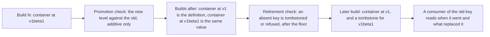

# 0020 design: Contract Promotion and Retirement

## How it works

Read it as the life of one key. The promotion check compares the new level against the old one, as the publish gate already compares two builds inside a level. Both keys ship from one build, so every module keeps matching. The retirement check later demands that the absent key be declared, and holds the withdrawal until the replacement has been published long enough.

## Design

The two movements are one mechanism seen from both ends. The tombstone's replacement field is the link a promotion needs, so promotion writes the record that retirement reads. Nothing here touches the matcher or the key model. Enhancement 0010 already allows two levels in one build for a break; the compatible case uses the same permission.

### Promotion ships two keys in one build

A promoting catalog publishes both levels in the same build. The outgoing level is defined as the incoming one, not restated, so one value backs two keys and they cannot drift. Every consumer of the old key keeps matching and migrates when it chooses. The old key is withdrawn later, under the retirement rules, never as part of the promotion. This is authoring posture and carries no requirement of its own.

### A promotion is declared, not inferred

A contract published at a higher level than it was born at carries `metadata.promotedFrom`, naming the level it came from. The field is absent on a contract born at its level. It stays on the member in every later build, so a reader of the artifact sees the origin. The origin must lie strictly below the member's own level on the ladder alpha, beta, stable. The field never enters a contract key, and a promoted contract matches only at its own level. Declaring the origin gives the check a key to look up and the artifact a permanent lineage.

### A promotion is checked against its origin

The publish gate keys its predecessor lookup on name plus level, so a member at a level never published before finds no predecessor and passes. Today `container` at stable can drop a field of `container` at beta and publish green. A member carrying `promotedFrom` is now compared with the newest published build that carries its name at the origin level, under the additive-only rule of enhancement 0010. A broken promotion is refused, naming both keys and the offending path. The comparison is the existing field-wise walk, which an earlier experiment of enhancement 0011 measured at 14 of 14 cases where CUE subsumption fails. Only the predecessor changes. The walk has never run over operands at different levels; the planned experiment stays a graduation gate.

A build promotes a contract or changes its shape, never both. A member carrying `promotedFrom` must be structurally identical to its predecessor. The author publishes the additive change at the origin level first and promotes in a later build. This costs one build and makes each release state one intent.

Skipping a rung is permitted and discouraged. A contract may be promoted from alpha to stable. The check applies against whatever level `promotedFrom` names. The guidance lives in the documentation, not in a check.

### A removal is declared, never blocked

A build is refused if it omits a member that an earlier build published at beta or stable, unless the same build carries a tombstone for that key. A key is present, tombstoned or refused. A publish gate cannot know who consumes a catalog, so a hard block would be arbitrary or useless. A tombstone states the key that went, the build it went in and why. It may name a replacement. A contract removed as a mistake has no successor, so the replacement is optional and its absence is not warned about. The reason is required: with no successor it is the whole value of the record.

Alpha members are never tombstoned. Alpha promises nothing, so an alpha contract that vanishes behaves as documented. Transformers carry no level, so they are outside the entry.

### The record is cumulative and sits on the catalog

Every build carries the complete tombstone history, not the delta. A consumer holding one build answers where a key went from the bytes in front of it, with no registry read. A build that drops a tombstone its predecessor carried is refused. The catalog gains a map of tombstones, keyed by the versioned contract key, beside the resource, trait and blueprint maps of enhancement 0015. Each tombstone repeats its own key, and a mismatch is rejected. A catalog with no such map stays valid. A tombstone cannot live on the member, because the member is what is gone.

### The clock is a floor on the producer

A tombstone that names a replacement is refused unless that replacement has been published for the minimum time. The unit and the value are open questions. This prices a withdrawal and forces no promotion, which is the indirect answer to permanent beta.

Enhancement 0010 rejected Kubernetes-style deprecation windows. Kubernetes needs one because a cluster upgrade withdraws an API version whether or not the workload is ready. Here a platform moves only when someone edits its own version, so a window that expired a consumer's pin would be arbitrary. That argument is about forcing consumers to move. This floor limits how fast a producer may withdraw a key. Nobody is expired, and the rejection stands.

### Where the rules run

Rules inside one artifact live in core as schema, checked by CUE: a promotion shape check and a tombstone shape check, unified into a non-hidden value because `cue vet -c` skips hidden fields. Rules that need a second build live in the cli beside the existing backward scan: absent-and-not-tombstoned, the promotion comparison and the seasoning floor. Enumeration there is a filesystem walk over the per-level filing, so these rules ship before the contract inventory of enhancement 0015. That inventory is needed only for a consumer-readable report. Core ships first, because the comparator needs the schema. The cli ships before the first real promotion in the first-party catalog, which is the proof case.

### The controller owns the stranding guard

This entry stops at the published artifact. Refusing a provider change that would take a contract from live instances needs a live dependency graph, which no publish gate holds. It belongs to the controller, beside the finalizer and shrink refusal of enhancement 0015.

### Amendments and compatibility

No requirement amends another entry. The tombstone rule closes a removal question that enhancement 0011 left open, and 0010, 0011 and 0015 are archived, so its own requirements are ADDED. Two requirements modify seeded ones. Every schema change is optional. Rollback has two halves: consumers pin the previous core, and the cli stops running the new checks. A published tombstone stays true, because published artifacts are immutable. A withdrawal cannot be rolled back, which is why the floor exists.

## Risks

- **The floor is unsatisfiable or trivial.** The first-party catalog publishes only alpha builds. Two blocking questions gate the value.
- **The raw Kubernetes family cannot obey promotion.** Its levels mirror upstream.
- **The promotion field reaches the match.** A field off the provenance list would conflict at unification. A blocking question settles it.
- **Dual-shipping doubles the gated surface.** Aliasing keeps one value, so the cost is one map entry and lookup per promoted contract.
- **The record becomes noise.** Keeping alpha out removes the churn.
- **The rules bind only the publish command.** A bypassing build can remove without a tombstone.

## Considered and rejected

- Considered inferring a promotion from the name; rejected because every new stable contract would look like one.
- Considered recording the promotion only in the tombstone; rejected because the two events are many builds apart.
- Considered leaving promotion ungated; rejected because a promise nothing checks is a convention.
- Considered requiring a byte-identical promotion; rejected because a contract may gain additive changes at beta first.
- Considered comparing with every build at the origin level; rejected because the newest already represents the rest.
- Considered forbidding or warning about rung-skipping; rejected because alpha promises nothing and a log warning is not a gate.
- Considered a matcher that follows a supersession edge on a miss; held in reserve, because a miss would become ambiguous. The tombstone records the edge as data, so adopting it later is additive.
- Considered a flag day per contract, or a bare name resolved at match time; rejected because the cost scales with adoption, and the second reintroduces the version join of enhancement 0010.
- Considered restating the outgoing level; rejected because two definitions of one shape can drift.
- Considered refusing a removal while consumers exist; rejected because a publish gate cannot know them.
- Considered leaving removal unrefused, or inferring the tombstone from the diff; rejected because a removing build passes every gate today, and only the author knows the reason.
- Considered a deprecation marker, the identity package or a separate artifact for the record; rejected because the member is what is gone.
- Considered requiring a replacement or making the reason optional; rejected because the first forces a false successor and the second empties the record.
- Considered a promotion deadline or no floor; rejected because a deadline has no consumer event to anchor it, and without a floor a build could promote and tombstone together.
- Considered tombstoning alpha members; rejected because ceremony at a level that promises nothing empties the label.
- Considered pruning tombstones by age; deferred as an open question.
