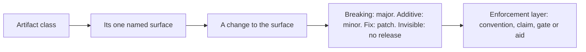

# 0021 design: OPM Versioning Policy

## How it works

Every class runs the same path. It names one surface a consumer may rely on. A change to that surface is classified once into a bump, by the ordinary SemVer table. What differs between classes is only the surface and how far the rule is enforced.

## Design

### One policy covers every published artifact

The policy covers every class a consumer can pin: the core schema, the catalog build, the catalog contract, the transformer, the module, the CLI template, the tooling train of kernel library, CLI and controller, the CRDs and the documentation. Each class answers five questions: what carries the version, what the surface is, what moves which number, what pre-stable means, and which enforcement layer applies. A class with an unanswered question is an open question here, not a class the policy ignores.

Out of scope: the test fixture fleets, the CLI's Go packages, and platforms until something publishes one. The controller install manifest is no class: it is a render of the controller module. The wire contracts between actors (the version ceiling, the CRD constants the CLI mirrors, the inventory digest, the label vocabulary) sit under the CRD class and are held by parity checks.

### A module's surface is its config schema

An instance is values unified against the module's config schema, and nothing else an instance authors reaches the module. So compatibility is subsumption: a release is non-breaking when it accepts every value the previous release accepted. Fewer values is a major. A strict superset (an optional field, a default, a looser constraint) is a minor. The same set is a patch. The bump is the maximum class across the schema, and a new required field is breaking. The schema is OpenAPIv3-shaped, so two releases compare mechanically. Stateful identity as a second surface, and how a default change counts, are open questions that complete this rule.

### Settled rules are copied word for word

Where an accepted entry or a repo document already decided a versioning rule, the policy carries it unedited under a line naming its source: enhancements 0010 and 0011, the commit-type tables of core and catalog_opm, the module major rule and the core schema-release spec. Enhancement 0020 is cited, not copied, while it is a draft. A copy is refreshed only when its source changes. The reader gets one complete page, and the argument stays where it was made. The text now lives in `evidence/policy/`.

### An alpha contract is encouraged to bump

An alpha contract promises nothing, and its publish gate stays off. The policy encourages an author who breaks one to bump the alpha number instead of reshaping the key in place. The bump is a courtesy at the convention layer. No gate refuses an in-place alpha break.

### A transformer serves a level by naming it

A transformer binds to exact contract keys, and a key embeds its level. So a transformer that serves several levels declares one registration per level, all sharing one body. The match path stays exact-key. When two levels differ in shape, each registration carries a projection into a canonical shape, and a level without a projection is not served. The catalog states which levels each transformer serves. This needs no schema change and no kernel change.

### A beta line promises a path to GA

A `-beta.N` line is pre-stable with a stronger promise than alpha. It is on the path to GA. A break is allowed only as a declared change with a migration note in the changelog. It advances the counter and never moves the module path to a new major. The prerelease lines are core on the v2 line, the kernel library, the CLI and the controller. Stable lines keep the stable table, so a break there is a new major, even when a dependency's beta break caused it. A core beta break that would force a major on a stable catalog line needs owner sign-off first. A beta release line is not a beta contract level. The two axes are independent.

### GA has written exit criteria

A beta line drops its suffix only when every exit criterion holds, except the one that is a guideline. The criteria are things a consumer can check from outside: the announced breaking change (enhancement 0013) is delivered; draft entries that would break a GA line are named; the controller's CRD version is decided; "latest" resolves to GA; no new pin names a prerelease of a GA line; templates and the quickstart are republished; GA releases are cut in dependency order (core, library, controller, the controller module's first v1, CLI); and a repository can cut a release branch before its line goes GA. For the first GA the controller serves `v1alpha1` with no conversion.

### The kernel library has an API-quality bar

GA freezes the library's exported API, so four criteria apply first. Render output is plain data, not a live CUE value. A caller tells each fetch or resolution failure by type, not by message text. The main specs pass strict validation, and the documents match the code. Three quiet betas in a row are evidence the API has settled, but that one is a guideline: the owner judges.

### The CLI ceiling compares MAJOR.MINOR

The CLI refuses a controller only when its `MAJOR.MINOR` is above the CLI's own, and ignores patch and prerelease. Each binary then releases patches and beta counters alone. A guard keeps this safe: no controller release needs a CLI newer than the newest released CLI. Installing the controller replaces it rather than drives it, so the running controller never refuses install. Install checks the controller version the module names instead. This amends the full-version ceiling of enhancement 0006. No seed of that behaviour exists, because the repos already state the shipped rule. The requirements are ADDED, and the history of the behaviour starts here.

### Release tags are immutable

No tag in a releasing organization repo is moved, deleted or re-created. A wrong release is fixed by the next version. A Go module retracts the bad one from its highest line. A version-named registry tag always names the content first pushed under it. Floating aliases (`latest`, per-PR and per-commit tags) may move. The module fleet is excluded for now. Three organization rulesets carry the guarantee for every actor: no tag update or deletion, with an empty bypass list; tag creation only by the release app; no deletion or force-push of a release branch. The CLI and the controller get immutable releases only after their draft-first flow ships a real release.

The documentation site pins sources per site version, which is the reason for the rule. Once the CLI has tagged a site version, every source ref is a tag or a full commit SHA, and a pin moves only by a reviewed commit.

### A released minor gets a lazy maintenance branch

A fix for a released minor lands on `release/<tag-prefix>vX.Y`, cut by one automated action from the newest tag of that minor, only when a fix needs it. The branch changes only by pull request, is never deleted and releases only patches. It is cut only when `main` has moved to a higher minor, and `main` never releases that minor again, so two lines never compute one version. A branch release never moves `latest`. No branch is cut before the automation is proven in a sandbox repository. During beta there are no release branches.

### The controller installs from a registry module

The controller ships as an OPM module published from its own repository. The CLI resolves a version from a registry, renders it and applies it as a CLI-owned instance. The controller never reconciles the instance that deploys it, so re-running the CLI is always the recovery path. The CLI embeds no manifest, and an air-gapped cluster uses a registry mirror. The module has its own train: path major `v0` until the controller reaches GA, one controller version per module version, named by tag and digest. Each CLI release names one default module version. This amends six decisions of enhancement 0006 (the embedded manifest, the noun-first group, the namespace-preserving uninstall and the instance ownership rules). As for the ceiling, no seed exists and the requirements are ADDED.

### Enforcement is layered

Each rule reaches one of four layers. Convention writes the rule down. A claim is a change that states its own bump. A gate refuses an under-claimed bump at publish. An aid is a check anyone may run. Catalogs reach all four. Modules reach the first two plus a gate that compares nothing yet. Core and the Go artifacts reach the first two. The module gate is scaffolded, not decided. A pilot of the catalog walk applied to the config schema classified every case in the module table, and it called a default change breaking.

## Risks

- **Authors route around the major.** An old field kept but ignored passes unification. The policy names it a break.
- **The config rule reads as the whole rule.** A volume rename can ship as a patch, so the stateful-identity question blocks accept.
- **Subsumption surprises an author.** A refusal names the field and the direction.
- **A publish outside the CLI carries no verified promise.** The policy says so in the catalog rule's words.
- **An immutable release burns a version on a mistake.** The cost is one number.
- **A tag rule is only as strong as its bypass list.** Only organization owners edit a ruleset, and the edit is audited.
- **Two lines release one version.** The cut action and the main release path both refuse that case.

## Considered and rejected

- Considered a module-only entry; rejected because the gaps are between classes.
- Considered per-repo notes only; rejected because they reach workspace contributors only.
- Considered the whole rendered output as the module surface; rejected as the sole surface because it moves with every platform change.
- Considered the component set as the surface; rejected because components are internal to the module.
- Considered paraphrase by reference to the source entries; rejected because a policy page must be complete on its own.
- Considered superseding the 0010 and 0011 rules into this entry; rejected because other repos cite their numbers.
- Considered gating alpha breaks; rejected because it empties the label.
- Considered an any-of form in required resources; rejected because it needs a schema change and a second matching rule.
- Considered a matcher fallback from a missing level; rejected because a miss becomes ambiguous.
- Considered additive-only from the first beta; rejected because a breaking change lands during beta.
- Considered a beta break crossing a module major; rejected because it resets the path to GA.
- Considered a GA exit checklist tracked in this entry; rejected because an entry stores rules, not progress.
- Considered keeping the full-version ceiling; rejected because counters restart at beta.1.
- Considered letting the ceiling refuse install; rejected because install is the recovery path.
- Considered moving tags to repair a release; rejected because pins and caches hold the first content.
- Considered ruleset bypass for admins; rejected because bypass is per ruleset and tooling carries the token.
- Considered immutable releases for every repo at once; rejected because the CLI and controller attach assets late.
- Considered a docs branch per fixed version; rejected because it froze every docs topic branch.
- Considered a release branch at every release; rejected because most minors never need one.
- Considered keeping the embedded controller manifest; rejected because the controller would be the one workload not deployed as a module.
- Considered embedding the module in the CLI; rejected because it brings back a second copy per release.
- Considered versioning the module with the controller; rejected because the image digest does not exist at commit time.
- Considered a `1.0.0-beta.N` line for the module; rejected because it looks coupled to the controller.
