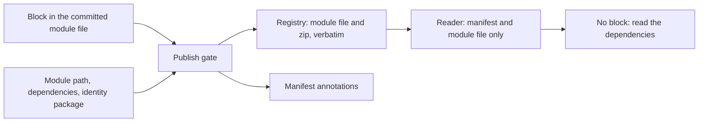

# 0022 design: Machine-Readable Artifact Metadata in cue.mod/module.cue

## How it works

Two channels, split by when a fact is known. Facts an author commits go in the block, and the gate checks them against the rest of the tree before anything is pushed. Facts that exist only at push time go into annotations. A reader answers its question from the manifest and the module-file layer, and falls back to today's parse when the block is absent.

## Design

### One block under a reserved key

OPM claims one key in the module file's reserved `custom` field: `"opmodel.dev@v0"`. The suffix is the block's own schema major. It changes only when a key changes meaning or is removed, never when a key is added, and a reader ignores keys it does not know. The block is plain data, because CUE parses the module file in data mode.

It carries four required facts: the kind (module, catalog or template), the identity (module path and version), the core line (major and the exact pinned version) and the catalogs (each catalog dependency with its pin, possibly none). It carries nothing about the toolchain. A reader holding the module file needs no other file to find it.

Modules, catalogs and templates carry it. `core` carries none, because nothing selects it by kind or compatibility, and the kernel library publishes no CUE artifact.

The block ends open. A key beyond the four passes this entry's validation unchecked, and only the entry that defines the key validates it. The key `listing` is reserved for a listing card that no live entry defines yet. The first draft closed the block, and the experiment refused a listing card with "field not allowed". The cost of the open tail is that a misspelled optional key passes the gate. A lint in the CLI that warns on keys it does not know catches it.

Dependency tidying keeps every value intact on 20 of 20 published fleet modules. It drops comments, sorts keys and expands one-line structs, and publish ships the tidied bytes unchanged. The registry therefore holds the values the tree holds.

### The block cannot lie

Three statements of one fact are safe only when something checks them where both copies are in hand, which is publish. Core ships a gate beside the identity package. It states each repeated field twice: as the block declares it, and as the module file and identity package imply it. The identity path is the module line, the identity version is the identity package's version, the core version is the dependency pin at the declared major, and the catalogs are the catalog dependencies at their pins.

Publish unifies the block against the gate and refuses a conflict with CUE's own diagnostic. The error names the field, both values and the writer command that repairs the tree. The gate is a definition, not a Go comparator, so the contract is stated once. It is applied the way the existing identity gate is applied. Which dependencies count as catalogs, and whether the kind is asserted against the path, are open in the proposal.

### Tooling writes the block, publish never does

The block is authored in the committed source, so the rule that published bytes are committed bytes stays intact. The tooling that already writes the tree keeps it in step. Scaffolding seeds the block with the identity package. Setting a version writes the same version to the block in the same operation. Re-identifying a template rewrites the block's module path with the module line.

Each write is surgical: comments stay, and a write is a no-op when the value already matches. A write also keeps every key it does not own, so a later entry's key survives it. This extends the single target that entry 0011 names for the version writer. The wording of that amendment is an open question in the proposal. Entries 0011 and 0016 are archived, so no requirement here amends a live entry. Two requirements modify the delivered ones of the version writer and the template re-identification.

### Push-time facts go to annotations

Which `opm` and which CUE toolchain published an artifact, and from which commit, exist only at push. Publish writes them as OCI manifest annotations beside CUE's own VCS keys, through the client call CUE provides. They are not in the zip, the module file or any committed byte, and no gate requires them. This is a placement policy and has no requirement of its own. The key set is open in the proposal.

### The first reader falls back

The first reader is the instance-initialisation walk of entry 0016. For each candidate major it reads the kind, refusing anything but a module, and the core major, comparing it with the CLI's core major. When the block is absent it parses the dependencies as it does today, and an artifact with no core dependency is incompatible. The two rules agree on any artifact published with the block, so no published artifact becomes unselectable. The report can say "template, skipped" instead of guessing from a path. This modifies the delivered requirement of the walk.

### A missing block warns before it refuses

Publish warns on a missing block from the release that ships the writer. From a later release, dated in the CLI changelog, it refuses. The module check reports the same condition. Artifacts already published are never affected. The date is the point: without one the fallback would become permanent.

Rollout order: core first, because a CLI against an older core finds no gate and skips it. Then the CLI, which lands the gate and the writer together. Then one writer run for each catalog and module tree, which changes only the module file. Then the site pages.

## Risks

- **A hand-edited block drifts.** The gate refuses at publish, the module check reports it earlier, and the writer is the command authors run.
- **Tidying normalises the block.** Values are plain strings and structs, so nothing depends on order or comments. A re-run on each CUE bump is the tripwire.
- **Upstream keeps `custom` by hand-maintained copies.** The workspace pins the CUE toolchain, and the tidy experiment is the OPM-side check.
- **The grace window becomes permanent.** The refusal date is a dated entry in the CLI changelog.
- **The 0011 amendment lands late.** Until it lands, 0011 says the writer has one target while the CLI has two. The effect is documentation only.
- **Cost forever.** One more definition in core, one more gate in publish and a second target for the writer. Annotations are invisible to CUE tooling.

## Considered and rejected

- Considered the key `opmodel.dev` with no suffix; rejected because CUE's stricter variant requires an `@vN` suffix and a published key is permanent.
- Considered manifest annotations for everything; rejected because no CUE tooling reads them, the gate cannot check them, and they are outside the content-addressed bytes.
- Considered a third OCI layer; rejected because CUE's client refuses a manifest without exactly two layers.
- Considered a sidecar artifact or a referrer; rejected because it needs a second publish step and can drift from the module it describes. It stays the path for a future second blob.
- Considered a block of only the facts the module file lacks; rejected because a reader should not need to know how dependency keys are spelled.
- Considered a toolchain record in the block; rejected because the tree cannot know who will publish it.
- Considered identity as a single path string; rejected because the identity package authors two named fields.
- Considered a closed block extended per core release; rejected because an older gate then refuses a newer block.
- Considered a block on `core`; rejected because core is the thing compatibility is measured against.
- Considered auto-fixing the block at publish; rejected because published bytes would no longer be committed bytes.
- Considered a comparator in Go; rejected because a second statement of the contract drifts.
- Considered generating the block into the pushed zip; rejected because the block would exist in no commit.
- Considered a separate sync command as the only writer; rejected because it is one more step to forget. A repair command may still exist for older trees.
- Considered no provenance at all; rejected because it is the one fact no parsing recovers.
- Considered refusing artifacts without the block in the reader; rejected because every older artifact would become unselectable.
- Considered refusing a missing block at once; rejected because every tree would fail its next publish for a field nothing reads yet.
- Considered never refusing a missing block; rejected because a block that may be absent forever cannot be relied on.
- Considered an OPM artifact specification; rejected because it loses CUE's package manager for every consumer.
- Considered deriving everything from paths and dependencies; rejected because kind is not derivable outside OPM's domains.
