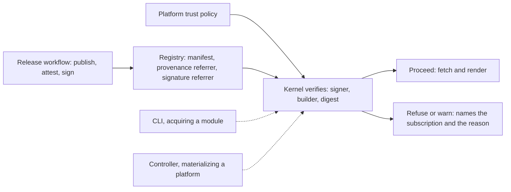

# 0023 design: Artifact Provenance, Signatures and Platform Trust Policy

The attachment channel and the policy owner are settled. The rest is a sketch that research and five unrun experiments confirm or replace. The open questions in the proposal name each gap.

## How it works

The release workflow publishes, then attaches two signed claims to the manifest digest. The platform states whom it trusts once. One kernel function checks the claims against that policy before an artifact's content is used, so the CLI and the controller never disagree.

## Design

### Claims attach beside the artifact

A claim is a separate OCI artifact whose subject is the manifest digest that the artifact's tag resolves to. It never names a tag. Nothing is added to the CUE module manifest, its config blob or its layers, so the artifact's digest does not change. A claim declares its kind, so a verifier can tell provenance from a signature.

Two kinds are in scope. Provenance is SLSA build provenance: who built the artifact, from which source, produced by the release platform and not by the author. A signature says who vouches for it. The two optional kinds, a capability manifest and an advisory, wait on open questions.

Referrers are the OCI standard way to attach a claim to a digest. CUE's client ignores them and its mirror carries them forward, as measured in the research note. A claim pinned to a digest survives a re-pointed tag, and the registry can serve it through the referrers API or the fallback tag keyed by digest. The claim is the same manifest either way. What GHCR does on push is not measured.

### The platform owns the trust policy

Whom to trust is declared on the platform. It is not declared on the artifact, in the CLI's configuration or on the cluster. The platform states the signer identities and builders it accepts, platform-wide, with an override per subscription.

The platform is where OPM already says what it consumes: enhancement 0019 pins exact versions and has a platform import its catalog whole. Stating whom it trusts beside what it pins keeps one place to read a cluster's supply-chain posture. This entry adds beside those subscriptions and modifies no requirement of another entry.

The sketch in `evidence/schemas/` holds accepted signers (an issuer plus a subject pattern), accepted builders, a required assurance level, a mode (`refuse` or `warn`) and the per-subscription override. A policy that accepts any signer from an issuer accepts every workflow of an organization, including a compromised one. So the policy names builders down to the workflow. Signing is identity-based and keyless. OPM holds no keys.

Where the policy lives, core's platform or a sibling in the generated platform package, is open. So are the identity vocabulary and the default mode.

### The kernel verifies before use

One kernel function takes a resolved manifest digest, the artifact's claims and a policy, and returns a verdict. A verdict holds the digest, the claims found, the identities checked, the policy applied, the outcome and whether the transparency log was consulted. The checks are that the signer is in the policy, the builder is in the policy and the claim's subject equals the digest that was resolved.

The function runs when a platform's subscriptions are materialized and when the CLI acquires a module. The controller refuses to reconcile a platform whose subscriptions fail a refusing policy, and says so in a condition that names the subscription and the reason. The CLI reports the same verdict and may refuse on request. A command checks one artifact against a policy on demand, so a too-strict policy fails in a way a person can read.

Before: resolve the tag, fetch, render. Trust is the registry's word. After: resolve the tag, list the claims, verify against the policy, fetch, render.

Whether verification must consult the transparency log online or may check an embedded bundle offline is open. The answer sets what an air-gapped platform can do.

### Release workflows produce the claims

In the release workflow, after publish yields the manifest digest, the workflow generates SLSA provenance and signs, both with the workflow's own identity through a public transparency service. The first-party catalog, module and core releases do this, and the CLI's templates carry it to authors.

The assurance level is stated per artifact family from what the tooling produces. Provenance from the artifact repo's own workflow is level 2 at best. Level 3 needs an isolated, reusable builder. Which level the releases reach is open.

### Optional claims wait

A capability manifest and signed advisories share the attachment channel and the policy owner. Each is a design of its own, with its own policy vocabulary, so the entry holds them as open questions. They may become separate entries.

### Rollout and rollback

Release workflows attest and sign first, because no consumer depends on it yet. Core gains the policy surface after the platform reshape of enhancement 0019. Library adds verification. The CLI and the controller land together. The entry lands after 0019 and beside or after 0022, whose catalog list may become the list a verifier walks.

Attachments are inert, so rollback stops writing them. With no policy, verification is off and a platform behaves as it does today. Nothing already published changes. A claim already in a transparency log stays there, by design.

## Risks

- **Verification depends on services outside the registry.** An outage or an air-gapped cluster cannot reach the certificate authority and the log. The policy mode is per platform so an air-gapped platform can choose.
- **Registry referrers support is uneven.** Claims may land under the fallback tag, which some tooling does not list. The first experiment measures push and list on GHCR and on the local registry.
- **A policy that is too easy to satisfy.** It names builders down to the workflow and states the required level.
- **The assurance level is overstated.** The level is stated per artifact family from what the tooling produces.
- **Two truths about a commit.** The unsigned commit annotation of enhancement 0022 and the signed provenance can disagree. The verifier treats the annotation as a hint and reports a disagreement.
- **Scope creep from the optional claims.** They stay open questions until decided or split.
- **A signing outage blocks releases, and verification adds a step to every render.** The step is one claim listing and one signature check, and it runs in the controller's reconcile loop.

## Considered and rejected

- Considered a third layer or a config-blob payload for claims; rejected because CUE's client refuses a module manifest without exactly two layers.
- Considered manifest annotations for signed claims; rejected because whoever pushes writes them and they carry no signature. They suit unsigned hints.
- Considered a parallel tag such as `v2.0.1.sig` as the primary form; rejected because the fallback tag keyed by digest is what makes a claim follow the artifact and not the tag name.
- Considered a transparency log with nothing in the registry; rejected because a consumer that resolves a tag holds the registry and may not hold the log.
- Considered policy in the CLI's configuration; rejected because a laptop setting never travels to the controller.
- Considered policy on the artifact; rejected because an artifact cannot vouch for itself.
- Considered a cluster-wide admission policy as the primary check; not chosen because it sees rendered objects and not the artifact that produced them. It stays a complementary layer.
- Considered doing nothing beyond registry immutability; rejected because a push with a valid token then looks like a release.
- Considered verifying by rebuild alone; rejected because it needs source and a toolchain at verification time. It stays a possible complement.
