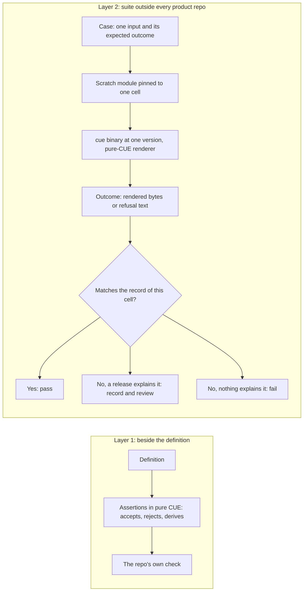

# 0024 design: CUE Testing and Conformance

## How it works

The two layers answer different questions and never share a run. Layer 1 runs at the one toolchain and the one set of pins a repo commits to. Layer 2 builds a scratch module per version cell, so it can compare versions, and it needs no checkout of a product repo. What it guards is not that behaviour never changes, but that no change passes unexplained.

## Design

### Two layers, one question each

The in-package layer asks whether a definition accepts, rejects and derives what it claims. It lives beside the definition, in the owning repo, and runs in that repo's own check. The conformance layer asks whether an unchanged input still produces the same bytes and the same refusal text across versions. It lives outside every product repo and consumes only published artifacts and `cue` binaries. Neither replaces the other, and neither replaces the Go harnesses of the kernel.

The split follows the owners and the cadence. A schema contributor needs an answer at the repo's check, in the same commit as the constraint. A release maintainer needs the cross-version answer once per release. A package pins exactly one core, one catalog and one upstream module, so it cannot compare versions of itself.

### A refusal's text is part of the record

The expected outcome of a case is captured verbatim. For an accepted input it is the rendered output. For a refused input it is the message lines of the diagnostic. A change in a message between two cells is drift, the same as a change in rendered bytes.

Messages are what an author reads. One overlong name has been measured to fail with two different messages under two spellings of the same constraint on one toolchain. Enhancement 0019 chose the spelling that names the offending string. Only a text comparison makes that choice an observable behaviour. A case may also declare the fragment it cares about, but the record is the full lines.

### Outcomes are recorded per version cell

A version cell is one combination of the CUE toolchain, core, the catalog and the upstream Kubernetes module. The record is keyed by cell, and a cell's outcome is expected to stay reproducible as long as its artifacts exist. When a new cell differs from its predecessor along one axis, the suite fails unless the difference is recorded as intentional. Recording a cell is a reviewed act, and its diff is the account of what that version changed.

Every axis is a published artifact: GHCR for OPM, the CUE Central Registry for the upstream module, released binaries for `cue`. A pre-release run against a branch-published tag is the same mechanism at a different version. The matrix grows faster than the corpus, so the policy is that every cell has a determinable outcome, not that every pull request runs the full product. Which cells a release runs is for the implementing change.

### Rendered objects conform to upstream

Every object a catalog transformer renders satisfies the upstream Kubernetes definition chosen by the object's own API version and kind. The catalog already unifies its outputs with those definitions at one snapshot, and that stays its in-package layer. The suite repeats the check at each snapshot in the matrix, so a field that upstream drops or tightens shows as drift on exactly the transformer that emits it. The raw Kubernetes catalog family is retired, so only the catalog transformers are in scope.

### The suite renders through the pure-CUE oracle

Render cases use pure-CUE unification of instance, catalog and transformer, which enhancement 0019 made the render contract. The suite needs no kernel and has the fewest moving parts. Rendering through the CLI would put the kernel and CLI versions on the axis of a suite whose subject is the CUE artifacts, and the parity harness already proves the kernel agrees with the oracle. A kernel axis stays an open question and would be an added axis, never a replacement.

The oracle is today published from a test fixture into an in-memory registry. A published or vendored form of that glue must exist before the suite can consume it.

### In-package assertions state rejection

An assertion beside a definition states what it refuses, in pure CUE, next to what it accepts and derives. The idiom was measured on one toolchain release: a comprehension guarded on the unification being bottom yields nothing when the value is rejected, and fails when it is accepted. A negative assertion is paired with a positive one on the same idiom, so an inert assertion shows. One assertion was inert in practice: it unified an unresolved disjunction and passed for every input. A comparison forces the choice and fixes it.

The layer asserts no message text. That belongs to the conformance layer. The existing habit of commenting out must-fail cases with their observed error is replaced by this idiom for new entries; old entries are not rewritten.

### Where the work lands

- **core** gains in-package assertions run by its existing check. No published definition changes, so the commits do not release.
- **catalog_opm** keeps its assertions and gains the byte-identity gate that enhancement 0019 relies on, run against the suite's record. The record must exist before the release that the sweep of that entry depends on.
- **library** supplies the oracle the suite renders with. Nothing in the kernel changes.
- **The suite** is new. Its repo, if it is one, and its place in the workspace repo list are an open question.

The first corpus holds the seven observable behaviours of the default-name change of enhancement 0019, three of them refusals, and one render case per transformer family. That is the shape of the first delivery.

### What the entry is not

It amends no other entry. It gives an existing gate an owner: the rule that no default-named golden output changes by a byte, and the default-name change beside it, both from enhancement 0019, live in this suite.

## Risks

- **Message churn drowns real drift.** The tool prints source positions under each message, and they shift every core release. The implementing change decides how positions are excluded, and a control case with a known-stable message detects a filter that cuts too much.
- **Export formatting drift looks like render drift.** A `cue` release can reorder keys or change quoting. The suite may compare a canonical form and records formatting-only cells as explained drift. The failure is loud either way.
- **The matrix outgrows the corpus.** Four axes multiply. A release runs the new version against its predecessor on each axis, and a scheduled run covers the rest.
- **A negative assertion passes on an incomplete value.** Pairing with a positive assertion and concrete evaluation in the in-package check catch it.
- **The upstream module names no Kubernetes release.** A claim such as "conformant with a given release" cannot be derived. The axis question decides.
- **The suite hardens today's behaviour, defects included.** That is the point of a record. A defect fix is intentional drift, explained and recorded. The suite never decides what is correct, only what changed.

Costs accepted: a second place to update when behaviour changes on purpose; possibly a Go runner for a pure-CUE subject; test files that may ship inside published modules; per-cell records that are repetitive by design.

## Considered and rejected

- Considered one in-package layer only; rejected because a package pins one version of each axis and cannot capture a message text.
- Considered one external layer only; rejected because a constraint and the case it exists to refuse belong in one commit, and an outside suite lags a release.
- Considered placing the suite in library; rejected because it must pin published builds and not depend on a checkout, and library's tests are the kernel's.
- Considered asserting only the exit status of a refusal; rejected because it cannot tell a message that names the string from one that does not.
- Considered one golden per case updated on every release; rejected because it erases the history and cannot tell a change on purpose from a change.
- Considered testing the branch heads of OPM before release; rejected as the default because the claim is about what consumers can pin.
- Considered rendering through the CLI; rejected as the baseline because it adds library and CLI versions to the axes.
- Considered negatives only in the suite; rejected because they would lag the schema by a release.
- Considered commented-out must-fail cases; rejected because a comment cannot fail.
- Considered the kernel's schema fixtures as the suite; rejected because they pin one core and one CUE per module and report schema drift in the wrong repo.
- Considered a canary per incident; rejected because it detects only shapes someone already got burned by and does not build a record.
- Considered applying the rendered fleet to the demo cluster per release; rejected because it tests admission, not schema behaviour, and cannot see refusal text.
