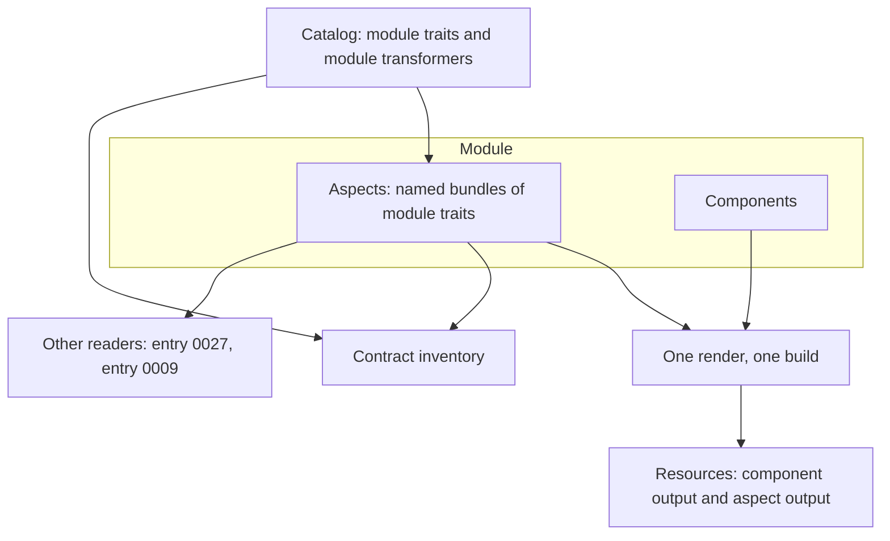

# 0025 design: Self-Describing Modules

## How it works

A module carries aspects beside its components. A catalog publishes the module traits an aspect attaches, and the module transformers that render them. The render matches an aspect the way it matches a component, into the same output, and the inventory covers both.

## Design

### A module states facts through aspects

A module gains one optional map of aspects, keyed the way components are keyed. An aspect is a named bundle of module traits. It is a sibling of a component, not a special case of one, so the rules a component follows apply to an aspect by transposition.

Each aspect attaches at least one module trait. It carries no resource, no blueprint and no name constraint, because a resource is a workload demand the platform must satisfy and an aspect describes the module. Its matching labels come wholesale from its attached traits, and an authored value that differs is refused. Its rendered object name defaults to the instance-qualified name and can be set per aspect. Its spec is closed over the attached traits' specs, and the author makes it concrete. A key that no attached trait declares is refused.

The spec is written inside the module, so it reads the module configuration and the components' computed names as a component spec does. A module with no aspect is valid and means what it meant before.

The refusals need explicit checks. On 2026-09-29, against core `main` 4c68be0 with cue v0.17.1, a probe that evaluated a module with an `#aspects` field succeeded, while the same probe with a regular `aspects` field failed with "field not allowed". CUE closedness does not cover definition fields. So core accepts a module that writes `#aspects` today, unvalidated, and nothing reads it.

Four needs each asked for a top-level field on the module: lifecycle in entry 0009, seed values in entry 0016, a status schema and an offerability flag. One named slot filled from catalogs answers the pressure as entry 0010 did for primitives: shapes in core, vocabulary in catalogs.

### A module trait is a sibling of a trait

Core defines a module trait beside the trait. It has the same identity block, matching labels, fulfilment, optional flag and spec. A catalog publishes it, keys it and gates it the same way, so the gates that hold traits hold module traits unchanged. It has no `appliesTo` and no name constraint, because it attaches to no workload.

A module trait cannot attach to a component, and a component trait cannot attach to an aspect. The catalog states `optional` as a default. An attachment can narrow it from true to false, never widen it and never pin it, which is the rule that entry 0010 sets for traits.

Two definitions that share one block cost less than one definition with a mode.

### A module transformer renders an aspect and nothing more

A module transformer is the component transformer transposed. It matches on an aspect's matching labels and attached module traits, and it has no resource buckets. It runs once per matched aspect and transformer pair, never per component. It takes the concrete module instance and one aspect. Whole-module facts reach it through the instance, never through a second input.

Its output is resources and nothing else. It never reads rendered component output, so the render stays one build, as enhancement 0019 requires, and aspects join that build. A module's rendered set is the union of component output and aspect output. A duplicate object identity is refused as it is today.

The library adds one matching pass keyed on aspects. It emits into the same output set. Frontends observe nothing new.

### An unhandled demand is never silent

A catalog carries module transformers beside component transformers, stamped the same way. A platform folds the enabled catalogs' module transformers as it folds component transformers. A disabled catalog contributes neither module traits nor module transformers.

The platform's contract inventory covers module traits and the module transformers that require them. That separates an aspect from an annotation with a schema. An aspect that attaches a required, catalog-fulfilled trait that no enabled transformer handles fails the render, naming the trait and the aspect. For an optional trait the same case is reported, with the same naming. This is the report-never-silence posture of enhancement 0015.

The coverage also works before any module exists: a platform reports a module trait that no enabled module transformer requires.

An aspect that no transformer renders is legitimate. It is a statement other tools read. Entry 0027 builds its offering declaration on that, and how such a trait states its fulfilment is the blocking question of the proposal.

### The extension point ships, the vocabulary does not

No catalog publishes a module trait or a module transformer under this entry. Network isolation and a resource budget appear as worked examples of what the slot is for. The entry's fixtures stand them up beside a declaration-only trait and one module transformer, attach them to a module, and pin the rendered object's name, labels and one field read from the module configuration.

A rewrite of the affected repos would be bound by the extension point, not by which two words a catalog published first. A module trait ships in the catalog change that publishes it, beside the entry that consumes it: the offering declaration with entry 0027, lifecycle and workflow traits with entry 0009, a rendered policy trait with the first platform that asks for one.

### Failure, order and rollback

A refusal names its subject. An aspect with no trait, an aspect that contributes a matching key of its own, and a spec key that no attached trait declares each fail at the aspect, naming the module and the aspect key. Every object a module transformer renders carries the instance label and the aspect's name.

Core lands before the library, because the kernel cannot match an aspect that core does not define. The inventory coverage lands with the matching pass. Without it, removing the pass would drop the module-scoped objects of a module with aspects and say nothing. Nothing waits on a catalog, because fixtures exercise the delta.

The change is additive. A module, catalog or platform with no aspect and no module transformer observes nothing. Nothing is removed or deprecated, and a component trait that stands in for a module-wide concern still renders. This entry amends no requirement of another entry. One requirement modifies the seeded contract inventory, and the rest are ADDED.

## Risks

- Extension-slot sprawl. A module trait is catalog-published under its own API version, the optional gate refuses a pinned posture, and the inventory turns an unhandled trait into a diagnostic.
- One slot, many consumers. Entries 0027 and 0009 can read like several designs under one title. The question here is one, and each consumer is its own entry resting on this one.
- A second matching pass per render. The cost that enhancement 0019 measured per component is small and linear, and aspects are few. Re-measure if a module with many aspects appears.
- A slot with no shipped instance. A design error surfaces only when the first consumer publishes a trait. The fixtures run a transformer end to end.
- Two attachment vocabularies. A catalog author asks whether a word is about a workload or a module. The schemas refuse the wrong one.
- The capability is invisible until a catalog publishes a module trait.

## Considered and rejected

- Considered a flat trait map at the module root; rejected because nothing names it, so two aspects of one kind with different specs are impossible.
- Considered a component that attaches only traits; rejected because it lies about scope to the component transformer contract.
- Considered annotations on the module; rejected because nothing types or versions them.
- Considered a separate service-module schema; rejected because it shares nothing with the module and needs a third for the next kind.
- Considered resources on an aspect; rejected because a resource is a workload demand.
- Considered a scope field on the trait, or an empty applies-to list; rejected because the field is required and every consumer would branch on a mode.
- Considered a post-processor over rendered output; rejected because it is a second build, which breaks the parity oracle.
- Considered a transformer with non-resource output; rejected because that makes a third interpreter beside the render and entry 0009.
- Considered component transformers reading aspects directly; rejected because nothing would render an object that belongs to no component.
- Considered aspects outside the inventory; rejected because a network-isolation aspect that renders nothing is a security hole with no diagnostic.
- Considered shipping two rendered traits as the proof; rejected because a vocabulary and its extension point are two questions.
- Considered shipping the field with no exercise at all; rejected because an unused extension point is a design, not a capability.
- Considered lifecycle as the first instance; rejected because it needs the execution half, which does not exist.
- Considered naming a successor entry for the rendered pair now; rejected because it would be a placeholder that ages.
- Considered a new top-level module field per concern; rejected because nothing then reports a field nobody implements.
- Considered facts kept outside the module, as hand-written objects, a policy engine or a bespoke controller; rejected because the fact does not travel with the module and cannot read its configuration.
