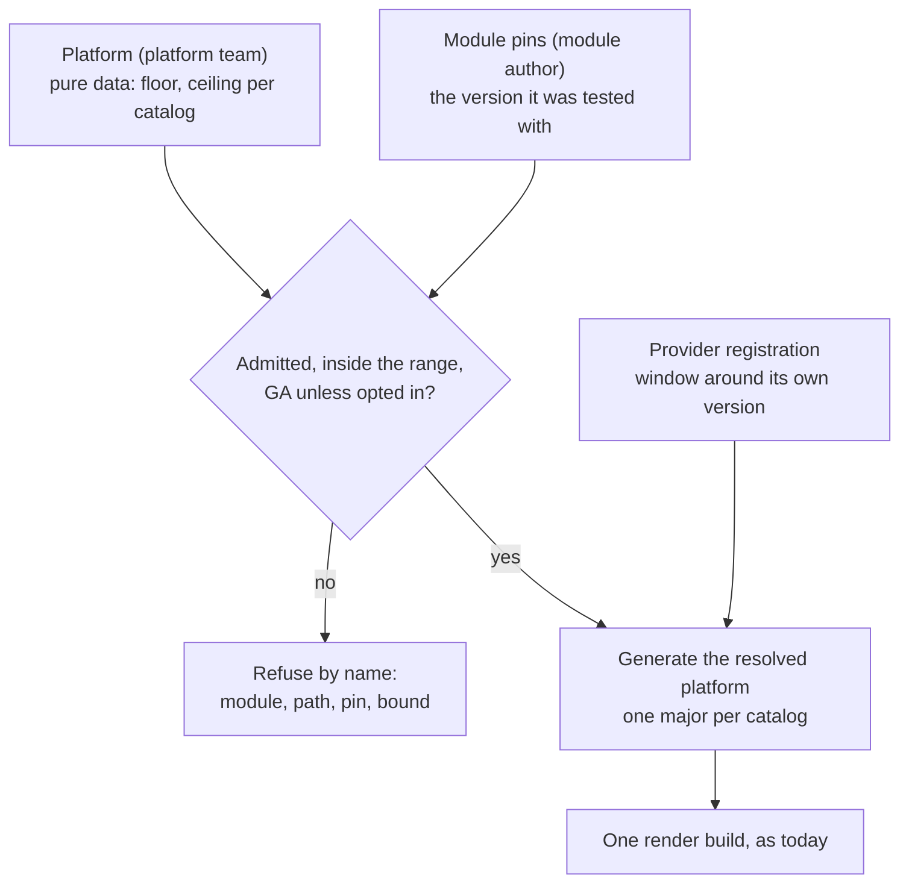

# 0026 design: Module-Dictated Catalog Versions and the Generated Platform

## How it works

Three inputs are written by people and committed to git: the platform's ranges, the module's pins, and each provider's registration. The kernel reads them, checks every pin against its range, and writes the one value nobody authors, the resolved platform the render builds against. The render itself is unchanged from today.

## Design

### The module's pin is the version

What the author tidied against is what the author tested. The render takes the version from the module's committed dependency list on every catalog path, and from the module's tidied closure on every other path, core included. No resolver, tidy or maximum-version selection runs at render. Each render records the catalog version it held on each path, and the record is part of its identity. Where that record lives is open.

### The platform admits and bounds

The authored platform is data. It imports nothing and has no dependency list. Each admitted lineage is one entry keyed by module path with its major: an enable flag, a required floor, an optional ceiling, an optional registry override, and a prerelease opt-in that defaults to off. The floor is required because the platform's own module-less build must import each static catalog at some version, and the floor is that version. The ceiling is optional because a required ceiling brings back a platform edit for every catalog release.

A pin below the floor or above the ceiling is refused, never moved up. Raising the floor is therefore the platform's fleet-wide lever, and it is a loud one: it stops the instances below it by name. A prerelease pin is refused unless the entry opts in, because semver orders a development tag above a floor in GA numbers. The same entry shape serves static and provider catalogs.

### Admission never loads

Listing a catalog in the platform puts it in no build. A catalog enters a build in exactly two ways: a module imports it, or an accepted registration supplies it. A static catalog that no module imports is absent from that module's resolved platform.

### The resolved platform is generated

The shipped render-time registry keeps its shape and is renamed the resolved platform. The name `#Platform` passes to the authored value. The kernel generates one resolved platform per distinct resolution, keyed by the resolved catalog set, the authored platform's generation and the accepted registrations, so renders that resolve alike share one. One authored value serves as the cluster resource spec and as the offline file. A hand-written platform module is no longer an input.

A render given no platform stays platform-less. The kernel generates its resolved platform from the render's own pins, holds every pinned catalog, and runs no admission, because there is no platform team and no fleet to bound. Today the CLI generates that platform; this entry moves the generation into the kernel. We do not synthesize a platform for it: an admission that can never refuse records nothing true. The old question that asked for this choice is closed.

### Providers follow the same rule

A provider module pins its own catalog. That version is the pick for any render that does not pin the catalog itself. The registration gains a window, a floor and a ceiling that default to its version. The provider author states it beside the operator release the module deploys. A platform admission entry for the path is optional. When present it replaces the window whole, and the registration's status reports which window is in effect and where it came from. A platform range wider than the author's window is accepted with a warning that names both bounds. A range that excludes the registration's version is refused.

### The checks run twice

A provider's requirement on a shared path must be at most the version the build holds there, within the same major. The check runs per render against the module's pins. It runs again at registration acceptance against the platform's floors, so a provider that no admitted render could hold is refused early. Acceptance success is necessary, not sufficient: the render-time check binds.

### Several majors side by side

A platform admits `opm@v4` and `opm@v5` as two entries, so modules move to a new catalog major one at a time. The major is settled before the resolved platform is written: each render holds the one major its module pins. No build meets two majors, so contract keys and matching stay as they are. Four things change around that rule.

- The module-less readiness build never holds two majors of one catalog, and a platform that admits two still evaluates and reports readiness. How the build is split is open.
- A provider joins only renders that hold the major it was built against. How resolution learns that major is open.
- The one-provider count is taken per resolution. Two providers serving different majors of the declaring catalog are both accepted. Two serving the same major are still refused.
- A module that imports two majors of one catalog is refused by name. Whether the same holds with no platform is open.

### What changes in the shipped specs

Four seeded rules change. The render list is promoted from the module's pins, not the platform's. The provider count is per resolution, in acceptance, in contract fulfilment and in the render guard. Acceptance compares a provider's requirements with the floor of the entry of its own major. The shipped registry is renamed. The Platform resource spec, the claim and its status gain the shapes above. The collision reports that shipped ahead of this entry stay as shipped.

## Risks

- A fleet can fragment across many catalog releases, and the platform cannot push a fix. A transformer fix reaches an instance only when its module re-releases. The floor stops laggards by name and never delivers the fix.
- Readiness weakens. A module above the floor may demand a contract the inventory at the floor never listed.
- A platform that widens past the provider's claim may get its output rejected by the operator the provider deploys. The warning names both bounds, and the claim survives as the baseline.
- A newer catalog's output may not suit the cluster it lands on. The additive promise covers input only. The provider window covers providers. Static catalogs have only the ceiling.
- A render with no platform can pass where a cluster platform would refuse it. The CLI names which source it rendered against.
- Until this ships, a major upgrade moves every module at once. The collision-tolerant fold and the operator's per-major index shipped ahead of this entry, so a platform with two majors reports its collisions instead of failing to evaluate.
- The per-major readiness split, if chosen, has a hole. A catalog at its floor may depend on one major of another catalog, and then fails the shared-path check in the slice of the other major.

## Considered and rejected

- Considered the platform's pin as floor and ceiling (today); rejected because the platform throttles catalog evolution.
- Considered a platform floor with the module allowed to raise it, resolved by maximum version; rejected because a pin below the floor would be moved silently.
- Considered a module that ships transformer code; rejected because the platform decides what code runs.
- Considered a required ceiling; rejected because it brings back a platform edit per release.
- Considered promoting a below-floor pin up to the floor; rejected because it is the silent re-route this entry removes.
- Considered a synthesized platform for a render given none; rejected because an admission that cannot refuse is ceremony.
- Considered the catalog major in every contract key; rejected because every major would re-key every contract and the owner rejected changing contract IDs.
- Considered a major as a matching scope; rejected because it reshapes every consumer of the inventory and puts provenance into matching.
- Considered intersecting the platform range with the provider's window; rejected because it can only narrow.
- Considered counting providers across the whole platform; rejected because providers of different majors would read as two providers of one contract.
- Considered one catalog major at a time; rejected because the upgrade stays all at once.
- Considered the earlier names for the authored platform and its entry; rejected because they leaked a Kubernetes convention and implied following new releases.
