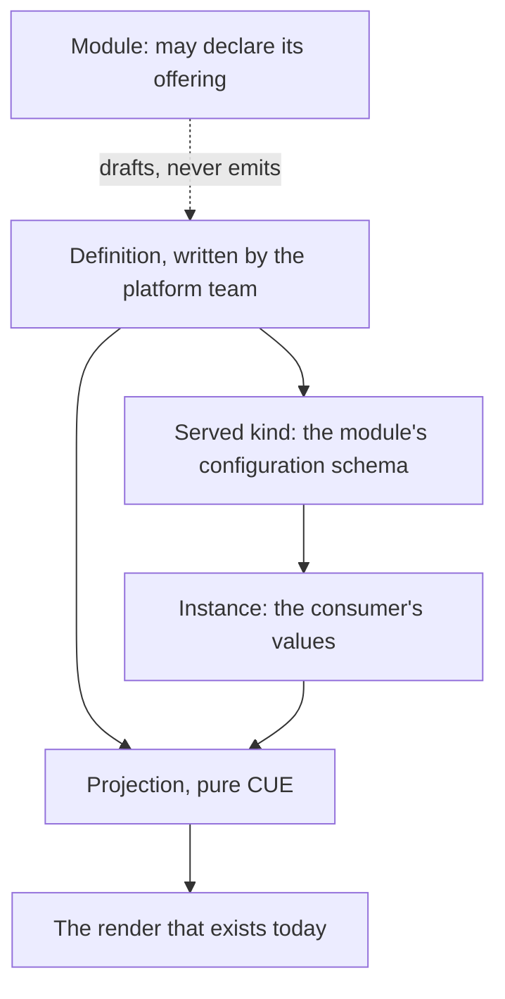

# 0027 design: Self-Service Kinds from Published Modules

## How it works

The platform team writes one definition per offered module. The definition and a consumer's values project, in pure CUE, to an ordinary module instance, and the render takes over. Where the definition names a group and kind, the controller also serves a kind whose schema is the module's own configuration schema.

## Design

### Two layers, binding then kinds

The binding layer is the definition, an optional reference to it from a module instance in place of a module path, and a tenant guardrail. The kind layer adds an API group and kind, a served schema and one data-driven controller. It adds no concept the binding layer lacks. It is a typed front over it.

Binding first gives platform-owned versioning and the guardrail with no dynamic CRDs. The dynamic cost sits in the kind layer: CRD lifecycle, dynamic informers and status mirroring, the meta-controller shape enhancement 0009 leaves open. As a projection onto the binding layer, it needs the projection written once. Whether the binding layer ships alone is open.

### The platform binds the module

A cluster-scoped, platform-owned definition binds a module lineage by its major-free registry path, one major, one release and an update policy. It may carry platform-bound values. The coordinate has one home per offering. Rebinding to another release re-renders every instance under the update policy.

A definition with no group and kind is valid and binds only. The definition is cluster-scoped for the reason enhancement 0015 gives for registration: it is a platform-team privilege, and a tenant can create a namespaced object. The consumer gets a namespaced instance.

### The platform writes the definition, the module may declare

The platform writes the definition by hand, or ships it as rendered output of a platform product module. That module attaches a catalog-published resource contract, and a catalog_opm transformer renders the object. The object then arrives as ordinary output applied under the tenant's ServiceAccount, so only a platform-team identity can create one. This is the gate enhancement 0015 uses.

The offered module never emits its own definition. A provider runs once per cluster. An offered module runs many times and must be instantiable before any deployment of it exists. A module that published its own offering would have to be deployed first.

The module may declare what it is when offered. This entry ships an `offering` module trait in catalog_opm, attached on an aspect under enhancement 0025. It carries the intended group and kind and a suggested update policy. The trait declares no match labels, so the aspect derives an empty match set and no transformer selects it. The CLI reads it from the published artifact, with no cluster, to draft a definition. The reconciler reports a disagreeing definition and does not refuse. The render carries it past and never branches on it. A declaration with no definition offers nothing.

A reader takes the trait spec and not the whole aspect, because on a bare artifact the aspect's instance-qualified name is incomplete. The trait ships here and not with 0025, because its shape and its only readers live here. How such a trait states fulfilment is an open question of enhancement 0025, and this entry follows the answer.

### One render path, one pure projection

Core defines the projection. Given a definition, an instance and the resolved module, it yields a complete module instance. The name and namespace are the instance's, the module is the bound one, and the values are the unification of bound and consumer values. A clash is refused. Neither side overrides, because a bound value is the platform's decision. A module other than the bound one is refused.

The kernel reads the projection, the CLI computes it offline, and the controller applies it. No frontend writes it again in Go. The render never learns that definitions or kinds exist. A projected instance renders and fails exactly as a hand-written one with the same module, name, namespace and values. The operational primitives of enhancement 0009 attach to module-instance transitions, so they fire for projected instances. This entry adds no hook vocabulary.

### The served schema is the module's own

Where a definition names a group and kind, the served schema is the bound module's configuration schema in structural form, and nothing else is authored. The API server refuses a bad instance before it stores it. A module whose schema cannot be encoded is refused as a target at acceptance, with the module and the reason. A module no one offers is unaffected.

The contract names the shape, not an encoder. The result must pass the Kubernetes structural rules and refuse no value the configuration schema accepts. The only exceptions are narrowings that an accepted answer to the open questions on bound fields, secrets, unions and computed fields allows.

Measured on 20 published modules: the stock CUE encoder fails on 19. Its output fails the structural rules even where it generates. A purpose-built walker produced CRDs that a real API server accepted for 20 of 20. Offline structural validation agreed with the API server on all 403 verdicts. The experiments are in evidence.

### A served kind is one namespaced object at the module's major

The API version is `v` plus the bound major, derived and never authored. Within a major the served schema changes only additively, which enhancement 0021 already requires of the configuration schema. Rebinding inside a major regenerates the schema in place, and stored instances stay valid. A release outside the bound major is refused.

The instance is namespaced, with no cluster-scoped composite behind it. The projected module instance is the render's input and not a consumer-facing object. The consumer's object carries a status mirrored from it: its conditions and a reference.

## Risks

- **Rebinding is a fleet re-render.** The update policy sits on the definition, and the blast radius is named in status.
- **Dynamic CRD lifecycle.** Deletion is refused while instances exist, naming the count. The CRD is regenerated only on rebind.
- **The structural rule surprises module authors.** The refusal names the module and the reason, and the CLI reports validity before binding.
- **A direct module instance bypasses the guardrail.** The guardrail is an open question.
- **Two definitions serve one kind.** Acceptance refuses the second and names the first.
- **The trait's fulfilment is another entry's answer.** This entry cannot reach accept before enhancement 0025 answers it.
- **A second way to deploy a module, and one CRD and informer per offering.** Accepted costs.

## Considered and rejected

- Considered a version allowlist on the existing module instance; rejected because the coordinate stays in the consumer's object. It survives as the guardrail half of an open question.
- Considered a namespaced definition; rejected because a tenant could create one.
- Considered binding modules in the Platform object; rejected because every offering change would become a Platform edit with the regeneration blast radius.
- Considered a hand-authored schema on the definition; rejected because it drifts from the configuration schema by construction.
- Considered preserving unknown fields when the schema is not structural; rejected because it silently drops admission checks and `kubectl explain`.
- Considered refusing only at publish time; rejected because older modules and modules never offered must keep publishing.
- Considered CUE's stock encoder as the contract; rejected on the measurement above.
- Considered a dedicated composition path for instances, as Crossplane and KRO have; rejected because it is a second interpreter of the components.
- Considered kinds with no binding layer; rejected because the projection, the definition and the guardrail are needed either way.
- Considered binding with no kinds; rejected because it leaves the API server without a schema or per-kind RBAC.
- Considered an offered module that does not know it is offered; replaced by the declaration, because the same need recurs across entries.
- Considered the offered module emitting its own definition; rejected on lifecycle.
- Considered an authored field on the module for the intended kind; rejected because it bakes a controller CR shape into core.
- Considered controller-synthesised definitions from module metadata; rejected because it needs privilege on a namespaced object and adds a second emission path.
- Considered projection in the controller only; rejected because the CLI could not reproduce a render offline.
- Considered consumer values overriding bound values; rejected because the override is what the platform bound the value to prevent.
- Considered a CRD version from the full release; rejected because every patch would be a new API version with no conversion.
- Considered one fixed `v1alpha1`; rejected because it hides a breaking schema change behind an unchanged version.
- Considered reconciling external APIs with 0009's `http` operations; rejected as the multi-year provider problem.
- Considered Crossplane's composite and claim topology; rejected because a module instance is already namespaced and owns its resources.
- Considered definition-level hooks on bind and rebind; rejected because the per-instance hooks already fire for each instance.
- Considered shipping the trait with enhancement 0025; rejected because its readers live here.
- Considered no declaration at all; rejected because the module author knows the intended kind and writing it costs nothing at the gate.
- Considered one generic kind validated by an admission webhook; rejected because it loses `kubectl explain`, per-kind RBAC and typed clients.
- Considered Crossplane's XRD with a Composition, KRO's graph and Kratix's Promise; rejected because each re-expresses in patches, CEL or pipelines what the module already states in typed CUE.
- Considered templated module instances from GitOps tooling; rejected because the API server still validates nothing.
