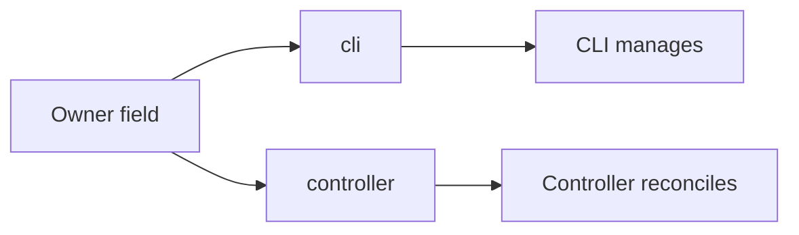

# 0030 design: Owner value is controller

## How it works

The owner field has two values. The value `cli` leaves the instance to the CLI. The value `controller`, or no value, leaves it to the controller.

## Design

### The value follows the name of the component

The controller was once called the operator, and the value was `operator`. When the component was renamed, the API value was renamed with it, so the value names who acts on the instance in the same word the rest of OPM uses. The shipped API accepts `cli` and `controller` and nothing else.

### Only the value and its holder change

The change touches the requirements that state the value, and the word for the controller inside them. The scenario names of those requirements stay as they are, because a delta cannot rename a live scenario. The other delivered requirements keep the older word until another change corrects them.

## Risks

- **Mixed wording.** Some scenario names and requirements still say "operator" after this change. Each one is a wording gap, not a different behaviour.

## Considered and rejected

- Considered rewriting every delivered requirement that says "operator"; rejected because it widens a record of one value into a rewrite of many capabilities.
- Considered a Purpose-only fix; rejected because the wrong value sits in requirements, not in a Purpose.
