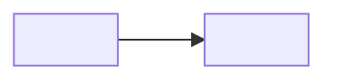

<!-- THE DESIGN. Owner: the proposer decides; an agent may draft. Reader: someone who asks "how does it work, and why this way?".
     It reads as one explanation, top to bottom. There are no numbered decisions.
     Advice: about 1,500 words in all, rejected options included. The checker warns, never refuses.
     At most 7 themes of about 120 words, in paragraphs of at most three sentences. -->

# NNNN design: <Title>

## How it works

<!-- One diagram, three sentences. At most 7 boxes, each a plain phrase. -->

<At most three sentences on what the diagram shows.>

## Design

### <Theme, as a plain phrase>

<!-- Stances live here. Say what the user sees first. Give the reason right after the thing it explains.
     An open question the owner has answered moves here from the proposal. -->

<What holds, and the reason, in short paragraphs.>

### <Next theme>

<...>

## Risks

- **<Risk>.** <What limits it, in one sentence.>

## Considered and rejected

<!-- "- Considered X; rejected because Y." One line each. List an option only if someone would propose it again. -->

- Considered <X>; rejected because <Y>.
